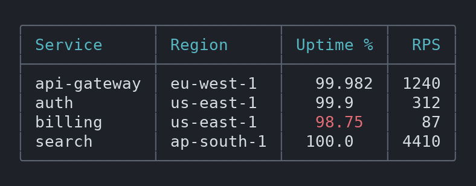
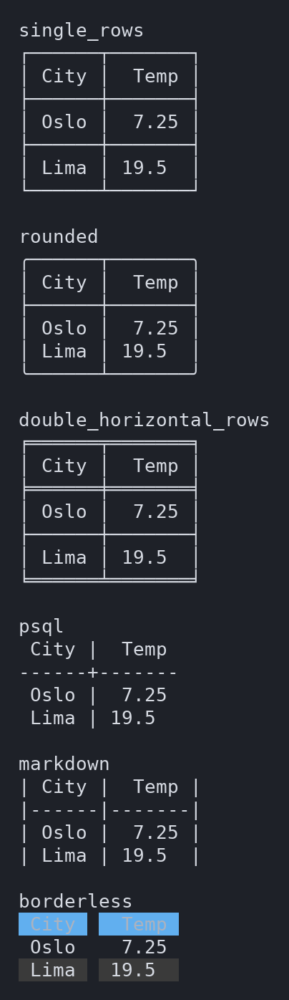
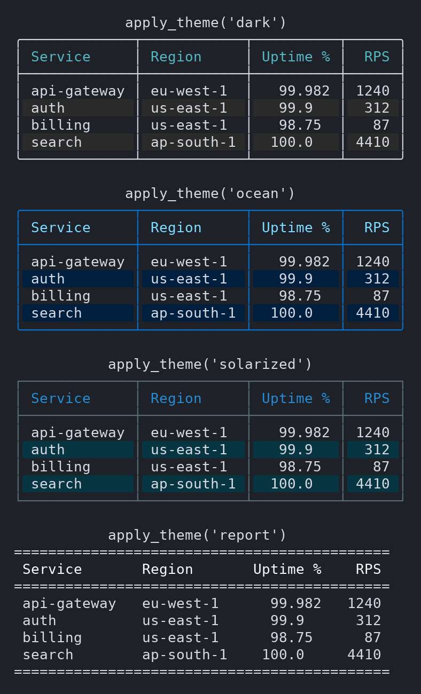
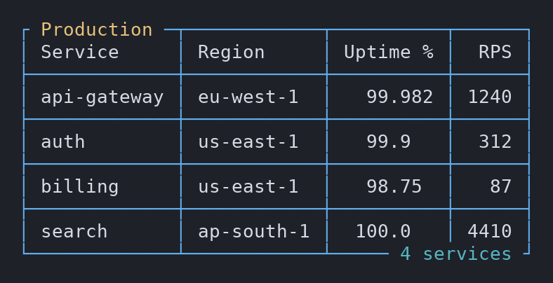
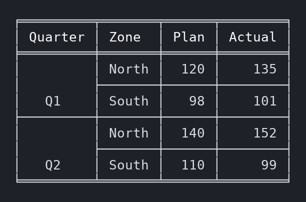
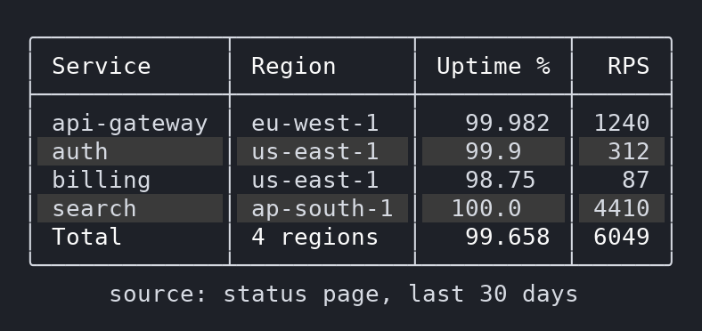
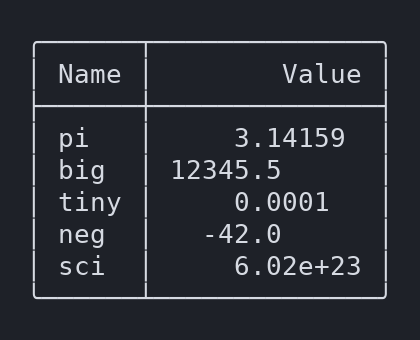

<p align="center">
  
</p>

<p align="center">
  <strong>Fast, dependency-free terminal tables for Python.</strong><br>
  54 border styles · ANSI colours · cell merges · decimal alignment · width fitting · CSV / Markdown / HTML / Excel / LaTeX I/O
</p>

<p align="center">
  <a href="https://pypi.org/project/flexablelib/"></a>
  <a href="https://pypi.org/project/flexablelib/"></a>
  <a href="https://github.com/Opus-Perpetuus/flexablelib/actions/workflows/tests.yml"></a>
  <a href="https://pypistats.org/packages/flexablelib"></a>
  <a href="https://pypi.org/project/flexablelib/"></a>
  <a href="https://github.com/Opus-Perpetuus/flexablelib/blob/main/LICENSE"></a>
  <a href="https://github.com/Opus-Perpetuus/flexablelib/blob/main/flexablelib/py.typed"></a>
</p>

---

**flexablelib** turns rows and columns into readable tables for terminals, logs,
reports and docs. It has **no runtime dependencies**, ships **prebuilt wheels
with an optional C speed-up**, and is covered by **1,000+ tests** on Python
3.8 – 3.14.

<p align="center">
  
</p>

## Install

```bash
pip install flexablelib
```

Optional extras: `pip install "flexablelib[pandas]"`, `"flexablelib[excel]"`,
`"flexablelib[html]"` or `"flexablelib[all]"`. The base install stays
dependency-free.

## 30-second quickstart

```python
from flexablelib import Table

table = Table(
    rows=[
        ["api-gateway", "eu-west-1", 99.982, 1240],
        ["auth", "us-east-1", 99.9, 312],
        ["billing", "us-east-1", 98.75, 87],
    ],
    headers=["Service", "Region", "Uptime %", "RPS"],
)
table.style_name = "rounded"            # 54 styles, see style_examples.md
table.header_color = "bold cyan"
table.color_rule = lambda value, row, column: (
    "red" if column == "Uptime %" and value < 99.5 else None
)
print(table)
```

```
╭─────────────┬───────────┬──────────┬──────╮
│ Service     │ Region    │ Uptime % │  RPS │
├─────────────┼───────────┼──────────┼──────┤
│ api-gateway │ eu-west-1 │   99.982 │ 1240 │
│ auth        │ us-east-1 │   99.9   │  312 │
│ billing     │ us-east-1 │   98.75  │   87 │
╰─────────────┴───────────┴──────────┴──────╯
```

Numbers align on the decimal point, colours never break alignment, and the
same table exports anywhere:

```python
table.to_markdown()                # GitHub / docs
table.to_html("report.html")       # self-contained, sortable, offline
table.to_csv("out.csv"); table.to_latex(); table.to_rst(); table.to_asciidoc()
table.to_excel("report.xlsx")      # pip install "flexablelib[excel]"
Table.from_csv("sales.csv"); Table.from_markdown(md); Table.from_pandas(df)
```

## Feature gallery

<table>
<tr>
<td width="50%"><b>Styles</b> — 54 presets, from <code>ascii_rows</code> to <code>borderless</code><br></td>
<td width="50%"><b>Themes</b> — <code>table.apply_theme("ocean")</code><br></td>
</tr>
<tr>
<td><b>Text on borders</b> — <code>table.border_text("Production", where="top")</code><br></td>
<td><b>Cell merges</b> — <code>table.merge_cells(0, 0, last_row=1)</code><br></td>
</tr>
<tr>
<td><b>Zebra rows, footer, caption</b><br></td>
<td><b>Decimal alignment</b> — floats and scientific notation<br></td>
</tr>
</table>

More: [all 54 styles](https://github.com/Opus-Perpetuus/flexablelib/blob/main/style_examples.md) ·
wrapping and ellipsis overflow · per-column / per-cell colour and alignment ·
vertical alignment · `paginate()` · `stream()` for live rows · `transpose()` ·
nested tables · `fit_terminal()` · `hide_columns` · `sort_by` · Roman / custom
index.

## How it compares

A factual feature matrix from our
[survey of 89 table libraries](https://github.com/Opus-Perpetuus/flexablelib/blob/main/docs/COMPARISON.md). A dash means
the feature was not found in that library's documentation during the survey,
not a claim that it is impossible there.

| | flexablelib | tabulate | prettytable | rich |
| --- | :---: | :---: | :---: | :---: |
| Runtime dependencies | **none** | none | `wcwidth` | `markdown-it-py`, `pygments` |
| Border style presets | 54 | many `tablefmt` | — (hrules/vrules toggles) | box styles |
| Decimal-point alignment | ✓ | ✓ | — | — |
| Row **and** column cell merges | ✓ | — | — | — |
| ANSI colours (header, rows, cells, borders) | ✓ | — | — | ✓ |
| Zebra rows / caption / footer | ✓ | — | — | ✓ |
| Text written on borders | ✓ | — | — | — |
| Wrap / truncate / ellipsis overflow | ✓ | — | max width | ✓ |
| Sorting, pagination | ✓ | — | ✓ | — |
| Exports | CSV, MD, HTML, Excel, RST, AsciiDoc, LaTeX | HTML, LaTeX, MD, RST, org, jira, … | HTML, CSV, JSON, LaTeX | — (console) |
| Readers | CSV, Markdown, HTML, dicts, pandas, Excel | — | CSV, DB cursor, HTML | — |
| Nested tables | ✓ | — | — | ✓ (renderables) |

rich is a full terminal-rendering toolkit (markup, live displays, progress
bars) and tabulate covers many more markup dialects; pick flexablelib when you
want a dependency-free, table-focused library with styling, merges and I/O in
one place.

## Production notes

- **Zero runtime dependencies.** Readers/writers that need a third-party
  package (`pandas`, `openpyxl`, `lxml`) are opt-in extras and imported lazily.
- **Performance.** Rendering 10,000 rows × 6 columns takes ~157 ms with the C
  extension (~172 ms pure Python), on par with prettytable, ~1.3× faster than
  tabulate and ~18× faster than rich's table. pandas `to_string()` is faster
  still (~85 ms). Full method and numbers:
  [docs/BENCHMARKS.md](https://github.com/Opus-Perpetuus/flexablelib/blob/main/docs/BENCHMARKS.md).
- **Wheels.** Prebuilt for CPython 3.8 – 3.14 on Linux (manylinux, musllinux),
  Windows x64 and macOS arm64. Anywhere else it builds from source or falls
  back to pure Python — installation never fails for want of a compiler.
  `from flexablelib.fast import implementation; implementation()` tells you
  which backend is live.
- **Colour safety.** Escape sequences are emitted only to a TTY by default,
  never when `NO_COLOR` is set; `FORCE_COLOR` or `table.use_colors = True`
  overrides. Logs and files stay clean.
- **Unicode.** Widths are measured in terminal columns, so CJK, emoji and
  coloured text stay aligned.
- **Windows.** Box-drawing styles need a UTF-8 console (`chcp 65001` or
  `PYTHONUTF8=1`; Windows Terminal is usually UTF-8 already). ASCII styles
  (`ascii_rows`, `ascii_double_underline_rows`, `psql`, `markdown`, …) work on any code page.
- **Typed.** Ships `py.typed` (PEP 561).
- **Stability.** flexablelib follows [semantic versioning](https://semver.org):
  within 2.x, public `Table` attributes and methods are not removed or renamed
  without a deprecation period; new features arrive in minor/patch releases
  and every release is listed in the
  [CHANGELOG](https://github.com/Opus-Perpetuus/flexablelib/blob/main/CHANGELOG.md).
- **Support.** Bugs and requests: [issues](https://github.com/Opus-Perpetuus/flexablelib/issues). Security reports:
  [SECURITY.md](https://github.com/Opus-Perpetuus/flexablelib/blob/main/SECURITY.md). Contributions:
  [CONTRIBUTING.md](https://github.com/Opus-Perpetuus/flexablelib/blob/main/CONTRIBUTING.md).

### Windows console encoding

```bat
chcp 65001
set PYTHONUTF8=1
```

(PowerShell: `$env:PYTHONUTF8=1`.)

# Guide

## Usage
Creating a table is simple.
### Code Example
```
from flexablelib import Table

new_table = Table()
print(new_table)
```
### Output
```
++
++
++
```
This is an empty table. It has no data so it only displays this strange thing.

A table that has columns but no rows — a query that came back empty — shows
its headers rather than raising:

```
┌──────┬───────┐
│ name │ value │
╞══════╪═══════╡
└──────┴───────┘
```

It's possible to add data as columns or rows, or even alternating each one. Any untitled column will be named automatically.

### Code Example
```
new_table.add_column('Name', ['Jade', 'John', 'Jane'])
new_table.add_column('Age', [20, 30, 40])
new_table.add_column('Results', [9.651, 3, 245.7])
print(new_table)
```

### Output
```
+----------------------+
| Name   Age   Results |
+======+=====+=========+
| Jade |  20 |   9.651 |
| John |  30 |   3     |
| Jane |  40 | 245.7   |
+------+-----+---------+
```

### Code Example
```
new_table = Table()
new_table.add_column('Name', ['Jade', 'John', 'Jane'])
new_table.add_column('Age', [20, 30, 40])
new_table.add_column('Test\nResults', [9.651, 3, 245.7])
new_table.add_row(['Piotr\nBaltimore', 27, 3.5])
new_table.add_row(['Sam', 21, 0.6519])
print(new_table)
```

### Output
```
+----------------------------+
| Name        Age       Test |
|                    Results |
+===========+=====+==========+
| Jade      |  20 |   9.651  |
| John      |  30 |   3      |
| Jane      |  40 | 245.7    |
| Piotr     |  27 |   3.5    |
| Baltimore |     |          |
| Sam       |  21 |   0.6519 |
+-----------+-----+----------+
```
As it is visible, the table will format automatically new lines and data types, for now without trying to parse strings that could be converted to another type.

The ``Table`` class offers a variety of options that allow things like showing the index of each row, changing the style of the table, hiding the headers, etc.

See style examples [here](https://github.com/Opus-Perpetuus/flexablelib/blob/main/style_examples.md).

### Code Example
```
new_table = Table()
new_table.add_column('Name', ['Jade', 'John'])
new_table.add_column('Age', [20, 30])
new_table.add_column('Test\nResults', [9.651, 3, 245.7])
new_table.add_row(['Piotr\nBaltimore', 27, 3.5])
new_table.add_row(['Sam', 21])
new_table.show_index = True
new_table.style_name = 'double_horizontal'
new_table.missing_value = '?'
print(new_table)
```

### Output
```
╒═══╤═══════════╤═════╤═════════╕
│ i │ Name      │ Age │    Test │
│   │           │     │ Results │
╞═══╪═══════════╪═════╪═════════╡
│ 0 │ Jade      │  20 │   9.651 │
│ 1 │ John      │  30 │   3     │
│ 2 │ ?         │   ? │ 245.7   │
│ 3 │ Piotr     │  27 │   3.5   │
│   │ Baltimore │     │         │
│ 4 │ Sam       │  21 │       ? │
╘═══╧═══════════╧═════╧═════════╛
```
The missing value aligns as if it was of the same type of the other data in the column.

**Changed in 2.3.0:** an explicit `None` is a missing cell, just like a
padding gap or `table.missing`. It displays `missing_value` (blank by default),
not the text `"None"`. Set `table.missing_value = '?'` to show gaps explicitly.
Use the string `"None"` if you want that literal text. This applies to printing,
`compose()`, pagination, streaming, and transposition in every style.

Missing cells do not turn numeric columns into text: numeric alignment and
the decimal axis are preserved, and `overflow='wrap'` does not split floats
because a column contains `None`. Raw `rows` and exports still represent gaps
as `None`; rendering `Table(rows=table.rows)` reproduces the same cells (copy
headers and display settings too if you changed them).

```python
table = Table(rows=[[924.87], [None], [1.25]])
assert 'None' not in table.compose()
assert Table(rows=table.rows).compose() == table.compose()
table.missing_value = '?'  # changes the display, not stored None values
```

See [missing-cell semantics](docs/MISSING_VALUES.md) for migration details.


This shows how to get the row and column count. If the index is shown, this count remains unaffected by that column, although, you can get the internal count.

### Code Example
```
new_table.show_index = False
new_table.show_headers = False
print(new_table)
print('row:', new_table.row_count)
print('columns:', new_table.column_count)
new_table.show_index = True
print(new_table)
print('internal_row_count:', new_table.internal_row_count)
print('internal_column_count:', new_table.internal_column_count)
```

### Output
```
╒═══════════╤════╤═════════╕
│ Jade      │ 20 │   9.651 │
│ John      │ 30 │   3     │
│ ?         │  ? │ 245.7   │
│ Piotr     │ 27 │   3.5   │
│ Baltimore │    │         │
│ Sam       │ 21 │       ? │
╘═══════════╧════╧═════════╛
row: 5
columns: 3
╒═══╤═══════════╤════╤═════════╕
│ 0 │ Jade      │ 20 │   9.651 │
│ 1 │ John      │ 30 │   3     │
│ 2 │ ?         │  ? │ 245.7   │
│ 3 │ Piotr     │ 27 │   3.5   │
│   │ Baltimore │    │         │
│ 4 │ Sam       │ 21 │       ? │
╘═══╧═══════════╧════╧═════════╛
internal_row_count: 5
internal_column_count: 4
```

## Colour

Colour the header, the borders, whole columns, whole rows, or individual cells.
Specs accept names, attributes, 256-colour indexes and hex triples.

```python
table.header_color = 'bold cyan'
table.border_color = 'grey'
table.column_colors = {'Service': 'bright_white'}
table.color_rule = lambda value, row, column: (
    'red' if column == 'Delta' and value < 0 else None
)
```

`color_rule` receives the original value, so numeric comparisons work directly.

Colour is emitted only to a terminal by default, and never when `NO_COLOR` is
set. `FORCE_COLOR` or `table.use_colors = True` overrides that. Because
`compose()` returns a string you may send anywhere, the default errs toward not
embedding escape sequences in something bound for a file.

Widths are measured in terminal columns, not characters, so coloured cells and
CJK or emoji data stay aligned.

## Reading and writing

```python
Table.from_csv('sales.csv')          # numeric columns parsed and aligned
Table.from_html(markup)              # standard library parser, no dependency
Table.from_dicts(records)
Table.from_pandas(dataframe)         # pip install flexablelib[pandas]
Table.from_excel('report.xlsx')      # pip install flexablelib[excel]

table.to_csv('out.csv')
table.to_markdown()
table.to_html('report.html', paginate=25)
table.to_excel('report.xlsx')
```

Since 2.2.0 every export writes the table as `print(table)` shows it: rows in
`sort_by` order (with `sort_reverse` and callables), `row_filter` applied,
`hide_columns` left out, and the text formats (`to_csv`, `to_markdown`,
`to_html`, `to_rst`, `to_asciidoc`, `to_latex`) hold the formatted strings —
`float_format`, `int_format`, `leading_zeros`, `custom_format`, `strip_cells` —
without padding or colour. Empty cells are empty strings.

```python
table.sort_by, table.sort_reverse = 'Uptime', True
table.row_filter = lambda row: row[1] < 99.9
table.float_format = '.1f'
table.to_markdown()                  # same rows, order and numbers as print(table)
```

`to_records()` keeps the stored Python values (numbers stay numbers, gaps are
`None`) in display order; `to_records(formatted=True)` gives the printed
strings. `to_excel()` writes numbers as numbers and turns simple format specs
(`',d'`, `'.2f'`, `'.1%'`, `'{:,.2f}'`…) into the cell's Excel number format.

`to_html` writes one self-contained file — the stylesheet and the sorting,
filtering and pagination script are inline — so it works offline and from a
`file://` URL.

Text formats deliver everything as strings, and a column of strings is
left-aligned. `parse_str_numbers` converts numeric-looking text so it aligns as
numbers; the readers turn it on for you:

```python
table.parse_str_numbers = True
```

Values with leading zeros are left alone, so `'007'` stays a string.

`table.rows` is a copy of the stored data, in insertion order and with `None`
in empty cells (sorting, filtering and formats do not touch it), so editing it
does not change the table. Use `add_row` and
`set_cell` instead:

```python
table.set_cell(0, 'Uptime', 98.2)    # row position, column position or header
table.set_cell(1, 2, table.missing)  # empty a cell
```

## Merging cells

Render a rectangular block as a single cell, across columns, down rows, or
both. Coordinates are inclusive, zero-based, and ignore the index column.

```python
table.merge_cells(0, 0, last_column=2, value='Quarter summary')
table.merge_cells(1, 0, last_row=3)                # keeps the top-left content
table.merge_cells(0, 0, 2, 2, value='Total', align='r')
```

A merge never widens the table -- columns are still sized by their unmerged
content -- so text longer than its span is truncated.

## Cards, grids and responsive tables

`Card` draws one record in a frame, in any of the table styles. The title goes
into the top border when the style draws one:

```python
from flexablelib import Card

card = Card(title='Ana', subtitle='Norte',
            fields={'Edad': 28, 'Ciudad': 'Guadalajara'},
            footer='actualizado hoy')
print(card.render(width=30))
```

```
╭─ Ana ──────────────────────╮
│ Norte                      │
├────────────────────────────┤
│ Edad    28                 │
│ Ciudad  Guadalajara        │
├────────────────────────────┤
│ actualizado hoy            │
╰────────────────────────────╯
```

`field_columns=2` (or `'auto'`) lays the fields out as a grid of tiles, and
`actions` adds `[ Action ]` chips:

```
╭─ Pedido 42 ────────────────────╮
│ Cliente         Total          │
│ José            $1,200         │
│ Estado          Fecha          │
│ Enviado         11/11          │
├────────────────────────────────┤
│             [ Ver ] [ Editar ] │
╰────────────────────────────────╯
```

Cards take `style_name`, `theme` (the table themes), `border_color`,
`title_color`, `label_color`, `value_colors`, `color` (a background for the
whole card), `zebra`, `panel` and `shadow`.

`table.render(width)` makes a table responsive: the normal table when it fits,
without its low-priority columns next, squeezed and wrapped after that, and
one card per row when nothing else fits. `width` defaults to
`max_width`, then the terminal width; `responsive=True` makes `print(table)` do
the same.

```python
table.title, table.title_position = 'Personas', 'border'
table.column_priority = {'Correo': 3}          # hidden first
table.card_options = {'subtitle_field': 'Grupo', 'fields': ['Edad', 'Ciudad']}
table.render(width=80)    # table
table.render(width=46)    # table without "Correo"
table.render(width=30)    # cards
```

```
╭─────────┬────────┬──────┬─ Personas ──┬──────────────────╮
│ Nombre  │ Grupo  │ Edad │ Ciudad      │ Correo           │
├─────────┼────────┼──────┼─────────────┼──────────────────┤
│ Ana     │ Norte  │   28 │ Guadalajara │ ana@example.com  │
│ Luna 🌸 │ Centro │   22 │ Mérida      │ luna@example.com │
╰─────────┴────────┴──────┴─────────────┴──────────────────╯

           Personas
╭─ Ana ──────────────────────╮
│ Norte                      │
├────────────────────────────┤
│ Edad    28                 │
│ Ciudad  Guadalajara        │
╰────────────────────────────╯
```

`Grid` places cards, tables, text and other grids in columns that reflow with
the width -- a grid of cards or a whole terminal screen:

```python
from flexablelib import Grid, GridCell

Grid(table.to_cards(), min_width=28).render(width=100)   # 3 columns, 2 at 62, 1 at 40
Grid([GridCell('Ventas de noviembre', span=3),
      GridCell(table, span=2), Grid(cards, columns=1)], columns=3)
```

More in [docs/LAYOUT.md](https://github.com/Opus-Perpetuus/flexablelib/blob/main/docs/LAYOUT.md).

## Notes

- A column named ``"i"`` does not collide with the index column (`utils.IndexColumnTitle`).
- Exponential numbers align on the decimal / exponent axis with the rest of the float column.
- Shrinking a float column drops decimals instead of chopping characters, so decimal alignment survives a terminal fit ([#23](https://github.com/Opus-Perpetuus/flexablelib/issues/23)).

Open work and the issue map: [docs/ISSUES.md](https://github.com/Opus-Perpetuus/flexablelib/blob/main/docs/ISSUES.md).

## Project Layout

```
flexablelib/                 # GitHub repository
├── flexablelib/            the Python package (no runtime dependencies)
│   ├── __init__.py          public API: Table, TableComposition, SeparatorLine
│   ├── table.py             the Table class — state and render orchestration
│   ├── columns.py           type inference, alignment, column widths
│   ├── style_compositions.py   the 54 border styles, as data
│   ├── table_strings.py     separator lines and data rows
│   ├── cells.py             cell padding, justification, wrapping
│   ├── options.py           constants and defaults
│   └── utils.py             type predicates and small helpers
├── tests/                   pytest suite — see ARCHITECTURE.md#testing
├── docs/                    issue history and design notes
├── logos/                   brand assets — see logos/README.md
├── ARCHITECTURE.md          how it all fits together
├── style_examples.md        all 54 styles rendered
├── package.json             canonical version number (no npm deps)
└── setup.py                 reads the version from package.json
```

Run the tests from the repository root:

```
pip install -r requirements-dev.txt
python -m pytest
```

See [**ARCHITECTURE.md**](https://github.com/Opus-Perpetuus/flexablelib/blob/main/ARCHITECTURE.md) for the rendering pipeline, how styles are defined,
and how to add one.
