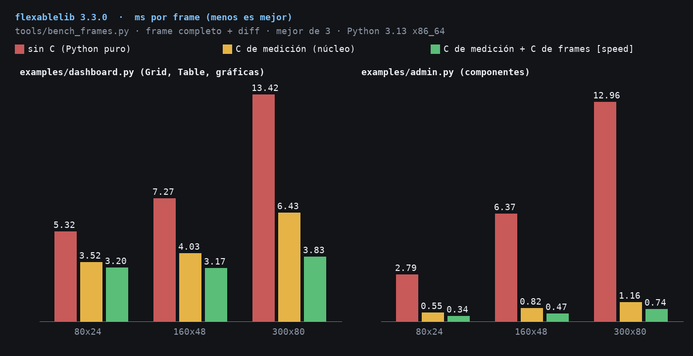

# C acceleration

flexablelib has two optional C modules. Both are optional at install time and
at run time; results are byte-for-byte identical with and without them.

| Module | Package | What it speeds up |
| --- | --- | --- |
| `flexablelib._speedups` | `flexablelib` (in the wheels) | text measurement: `visible_width`, `strip_ansi`, `pad_to_width`, `widths_of` -- the data side (tables). |
| `flexablelib_speedups._frames` | `flexablelib-speedups` (`pip install "flexablelib[speed]"`) | interface frames: `fit_line` / `fit_lines` (cut and pad lines to an exact width, ANSI-aware), `slice_columns`, `truncate`, `border_grid` (the junction glyphs of a shared border, computed for the whole grid at once), `changed_lines` / `render_diff` (the minimal update a live screen writes). |

`flexablelib._frames` is the front door: grids, cards, widgets, the `App`,
`Live` and every component call it. With `flexablelib-speedups` installed it
binds the C functions; otherwise the Python ones (which still use the core
C measurement when the core wheel has it).

```python
from flexablelib import _frames
_frames.BACKEND          # 'c' or 'python'
_frames.use('python')    # switch at run time ('c', 'python', 'auto')
```

`FLEXABLELIB_FRAMES=python` in the environment starts on the Python code.

## Correctness

`tests/test_v330_frames.py` runs every primitive in both backends on fixed
cases (wide CJK, emoji with variation selectors, combining marks, ANSI colour
and OSC 8 links, tabs and control characters, widths of 0 and 1) and on
thousands of random strings, and requires identical output. The whole suite
also runs with `FLEXABLELIB_FRAMES=python`, with no optional packages
(`FLEXABLELIB_CORE_ONLY=1`), and with both C modules on Linux, Windows and
macOS in CI.

## Benchmarks

`python tools/bench_frames.py [--demo admin] [--pure] [--json out.json]`:
milliseconds per complete frame -- re-layout, redraw and the diff against
the previous frame -- cycling through 8 different screens, best of three
runs of 40 frames. `--pure` hides the core C module too.

Machine: 8-vCPU Intel Xeon (cloud VM), Linux x86_64, CPython 3.13.5,
flexablelib 3.3.0.

### examples/dashboard.py (Grid, Table with merges, widgets)

| Size | No C | Core C measurement | + C frames (`[speed]`) | Speed-up vs no C | Diff bytes/frame |
| --- | ---: | ---: | ---: | ---: | ---: |
| 80x24 | 5.32 ms | 3.52 ms | **3.20 ms** (313 fps) | 1.7× | 1,363 |
| 160x48 | 7.27 ms | 4.03 ms | **3.17 ms** (315 fps) | 2.3× | 2,057 |
| 300x80 | 13.42 ms | 6.43 ms | **3.83 ms** (261 fps) | 3.5× | 3,157 |

### examples/admin.py (App, AppShell and components, dialogs)

| Size | No C | Core C measurement | + C frames (`[speed]`) | Speed-up vs no C | Diff bytes/frame |
| --- | ---: | ---: | ---: | ---: | ---: |
| 80x24 | 2.79 ms | 0.55 ms | **0.34 ms** (2,930 fps) | 8.2× | 3,007 |
| 160x48 | 6.37 ms | 0.82 ms | **0.47 ms** (2,127 fps) | 13.5× | 7,160 |
| 300x80 | 12.96 ms | 1.16 ms | **0.74 ms** (1,349 fps) | 17.5× | 16,753 |

For reference, the 3.2.0 dashboard took 5.0 / 7.5 / 15.2 ms per frame at
the same three sizes. The remaining cost of the dashboard is the table
itself (column fitting and merges), which is data work rather than frame
work.



## Building from source

`flexablelib-speedups` is a plain C extension with no dependencies:

```
pip install ./packages/speedups            # from a checkout
cd packages/speedups && python setup.py build_ext --inplace
```

Without a compiler the install still succeeds without the C module and
flexablelib uses its Python frame code.
