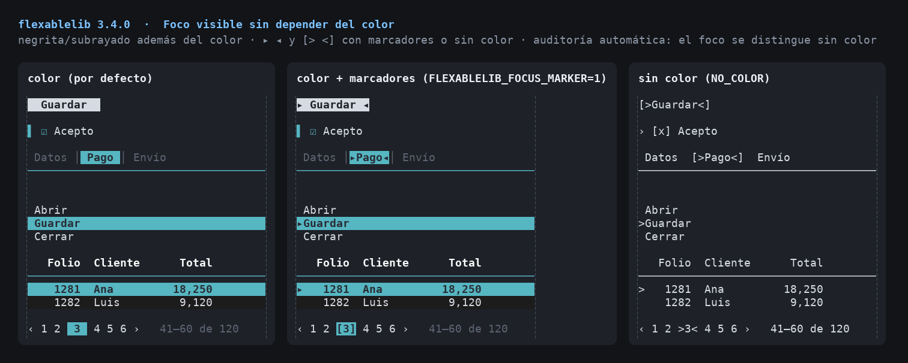
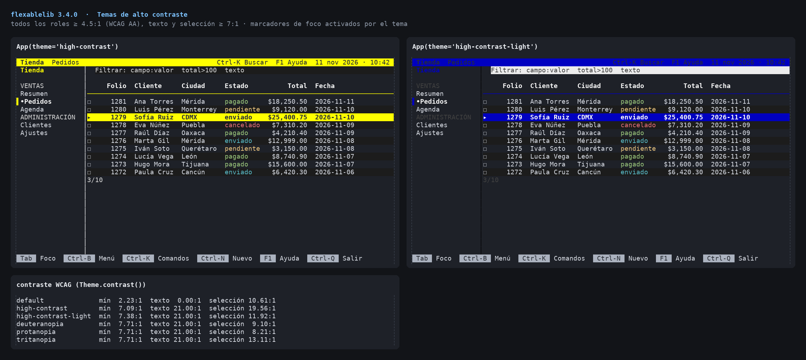
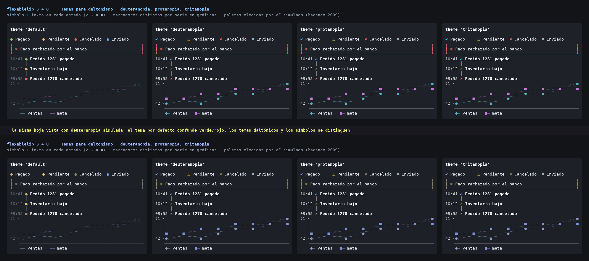
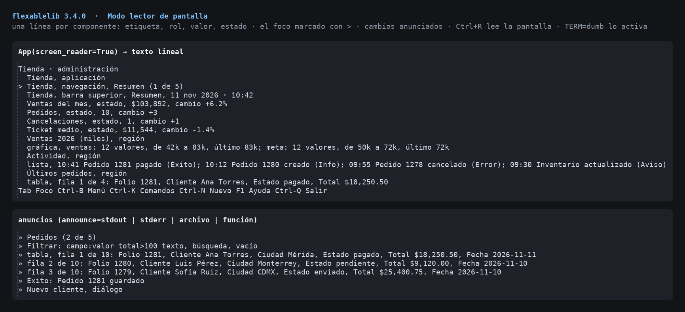
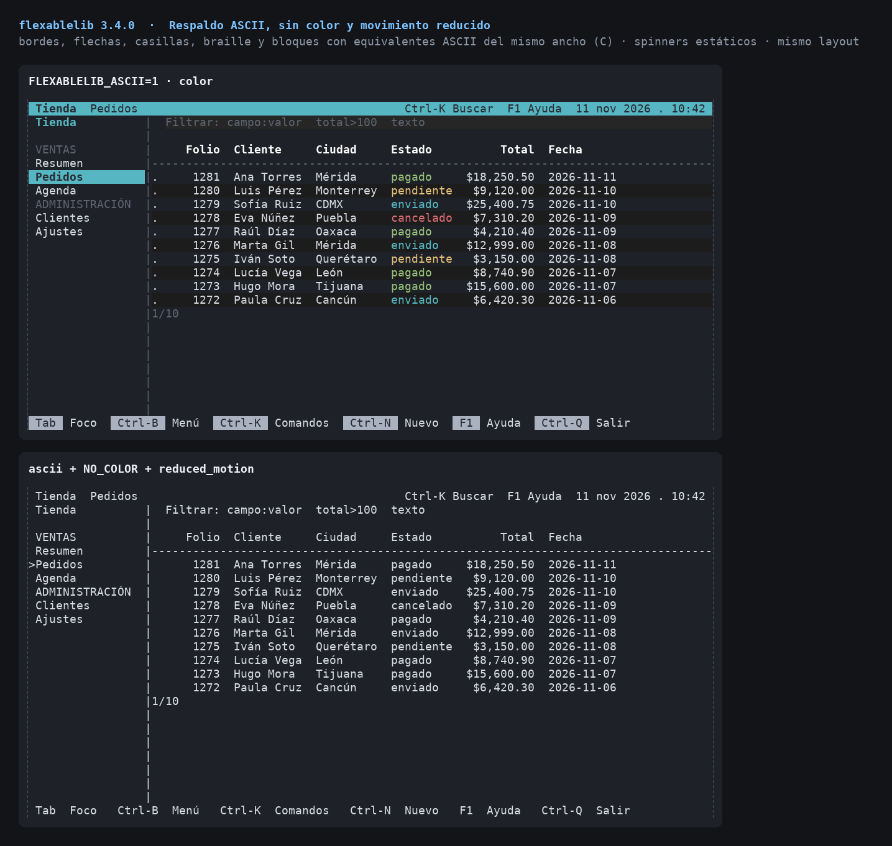

# Accessibility

`flexablelib-tui` and `flexablelib-components` aim to be usable with **only
a keyboard, without colour, without Unicode, with motion turned down and
with a screen reader**. This page lists what the library does, the
settings, and the automatic checks that keep it that way.



## Settings

All switches live in `flexablelib_tui.accessibility.settings`. They are read
from the environment and an `App` argument overrides each one for that app:

| `App(...)` argument | Environment | Effect |
| --- | --- | --- |
| `screen_reader=True` | `FLEXABLELIB_SCREEN_READER=1` | linear text instead of a drawn screen, change announcements |
| `announce='stdout'` | | where announcements go: `'stdout'`, `'stderr'`, a path, a stream or a callable |
| `reduced_motion=True` | `FLEXABLELIB_REDUCED_MOTION=1` | spinners and skeletons stand still |
| `ascii=True` | `FLEXABLELIB_ASCII=1` | ASCII borders, symbols and key names |
| `focus_marker=True` | `FLEXABLELIB_FOCUS_MARKER=1` | focus and selection shown with text markers in colour too |
| `theme='high-contrast'` | `FLEXABLELIB_THEME=high-contrast` | theme for every component that did not choose one |
| `lang='en'` | `FLEXABLELIB_LANG=en` | language of roles and states (`es` by default) |
| `min_size=(60, 16)` | | a message instead of a squeezed screen |
| `title='Clientes'` | | the application name read first |

`FLEXABLELIB_A11Y=1` turns on `focus_marker` and `reduced_motion` together.
`accessibility.configure(...)` changes the process-wide settings and works
as a context manager (`with configure(ascii=True): ...`).

### Colour environment

- `NO_COLOR` (any value) turns colour off and wins over everything else.
- `FORCE_COLOR=0|1|2|3` forces none, 16, 256 or true colour, even into a
  pipe.
- `TERM=dumb` turns colour off and, for a real terminal, switches the app
  to screen-reader (linear) mode, since there is no cursor addressing.

Without colour the layout is the same and no escape sequence is written;
focus and selection move to text markers (below).

## Keyboard

Everything works with the keyboard alone:

- Tab / Shift+Tab move the focus in screen order; `tab_index` changes the
  order (`-1` leaves a component out of Tab while clicks still focus it);
- modal dialogs trap the focus and give it back when they close;
- F1 opens a help screen built from the key bindings and their
  descriptions (`App(bindings={'ctrl+s': (save, 'Guardar')})`);
- in screen-reader mode Ctrl+R reads the whole screen again;
- every action can be remapped with a `KeyMap` (see [INPUT.md](INPUT.md)).

## Focus visible without colour

Focus never depends on colour alone. Without colour (or with
`focus_marker=True`) the focused component shows a text marker: `>` before
inputs, buttons as `[>Guardar<]`, tabs as `[>Clientes<]`, menus and lists
with `>` on the current item, pagination as `>3<`, a heavy frame on the
selected catalog card. With colour, the default theme also makes the
selection bold, and the accessible themes keep the text markers on, so
focus survives monochrome screens and colour-blind eyes.

## Themes



`Theme.preset(name)` or `App(theme=name)`:

| Theme | For |
| --- | --- |
| `default` | everyday use |
| `high-contrast` | black background, white and yellow; text and selection ≥ 7:1 (WCAG AAA), every other pair ≥ 4.5:1 |
| `high-contrast-light` | the same on white |
| `deuteranopia`, `protanopia` | red/green colour blindness: sky blue and amber (Okabe–Ito) instead of green and orange |
| `tritanopia` | blue/yellow colour blindness: cyan, yellow and red, violet instead of blue |
| `monochrome` | bold, underline and reverse only |



The tests compute the WCAG contrast ratio of every foreground/background
pair of each theme (`contrast_ratio`) and simulate the three colour vision
deficiencies (`simulate_cvd`, Machado et al. 2009) to check that success,
warning and error colours stay apart (`delta_e`).

## Status: symbol and word, never colour alone

Badges, alerts, notifications, timelines and validation messages carry a
symbol and a word as well as a colour: `✔ Éxito`, `⚠ Aviso`, `✖ Error`,
`ℹ Info` (`+ ! x i` in ASCII mode). Chart series use different markers.
`status_symbol(kind, word=True)` gives them to your own components.

## Screen readers



With `screen_reader=True` the app writes **linear text**, one line per
component, instead of drawing a screen: label, role, value, state and
description, the focused one marked `>`:

```
Clientes
> Nombre, campo de texto, vacío
  Activo, casilla, sin marcar
  Guardar, botón
```

Changes are **announced**: focus moves, new values, opened dialogs,
notifications, errors. Announcements are deduplicated and go to
`announce=` (a speech synthesiser can read a file or a callback).

Every component has a `role` (`button`, `checkbox`, `combobox`, `grid`,
`tablist`, `dialog`, `alert` ...), an accessible name (`a11y_label`, or its
label, title, placeholder or name), a value (`a11y_value()`: the text of an
input, "3 caracteres" for a hidden password, "fila 1 de 120: …" for a table)
and states (`a11y_state()`: checked, expanded, selected, required,
invalid, busy, disabled). `describe(component.a11y())` builds the sentence.
Your own components set `role` and override those methods.

## Reduced motion and ASCII



- `reduced_motion`: spinners show one still frame plus their text,
  skeletons do not shimmer, nothing moves on a timer.
- `ascii`: borders become `+-|`, symbols and arrows ASCII stand-ins, key
  names words (`Arriba`). It is applied to the finished frame by
  `ascii_fold` (C-accelerated, with a Python fallback that gives the same
  result). It turns on by itself when the terminal cannot show Unicode.

## Small terminals

Layouts reflow (the sidebar hides, cards wrap, tables squeeze columns).
Below `min_size` the app shows "Ventana muy pequeña — 40×12, se necesitan
60×16" instead of an unreadable screen.

## Automatic audit

```python
from flexablelib_tui import accessibility
for issue in accessibility.audit([my_form, my_table]):
    print(issue)            # AuditIssue(Button, 'label', 'no label')
```

`audit` renders each component focused and unfocused, with and without
colour, and reports a missing role, a missing label, and focus that is not
visible (the plain text and the bold/reverse/underline attributes must
change, not only the colours). The test suite audits **every** component
under every theme, and checks theme contrast and colour-blind contrast,
so a new component cannot ship without them.
