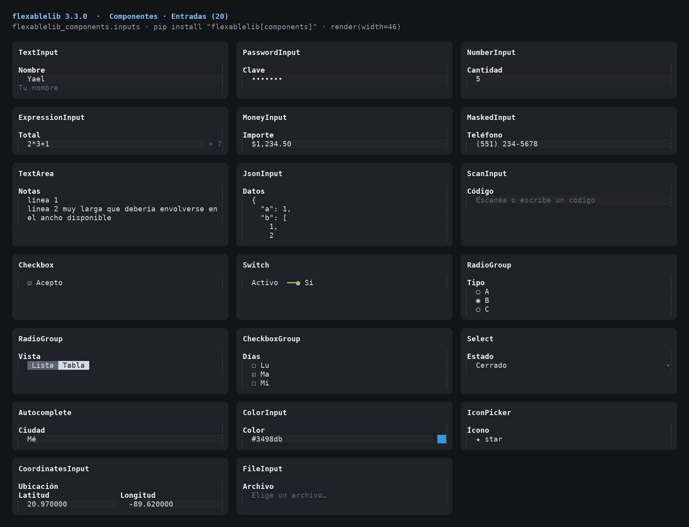
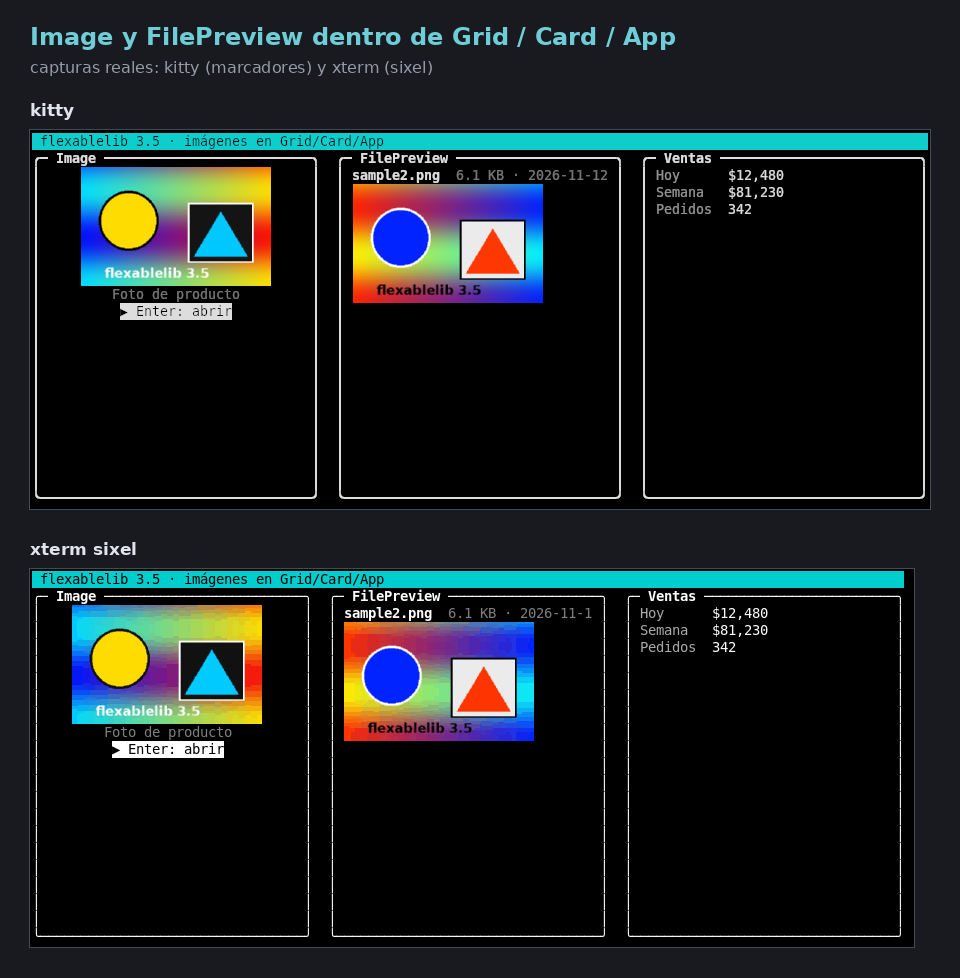
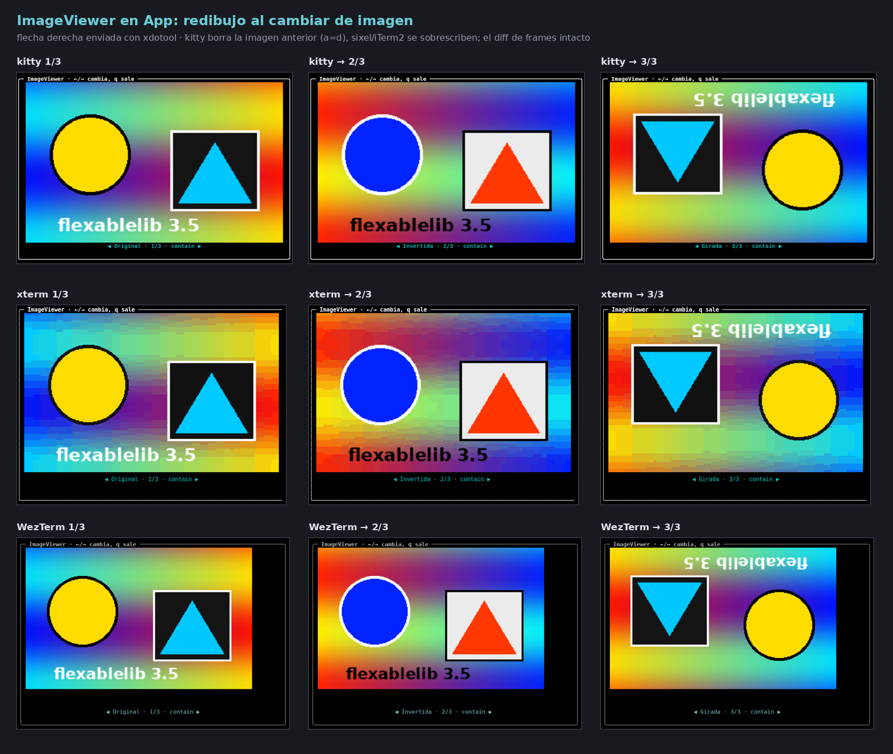
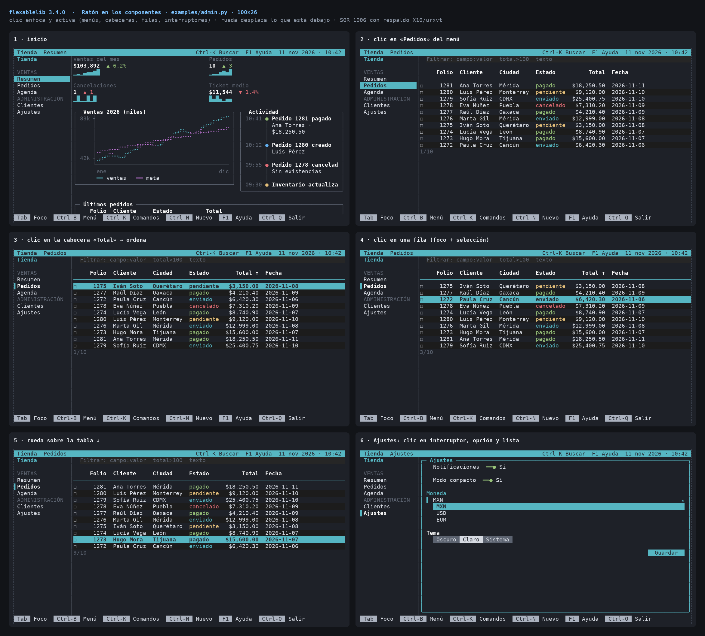
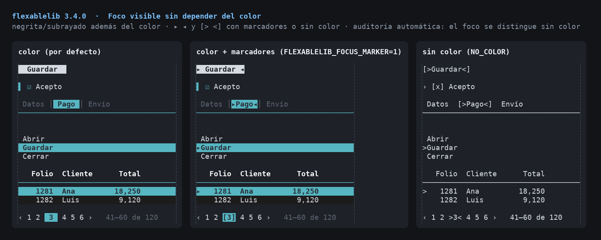
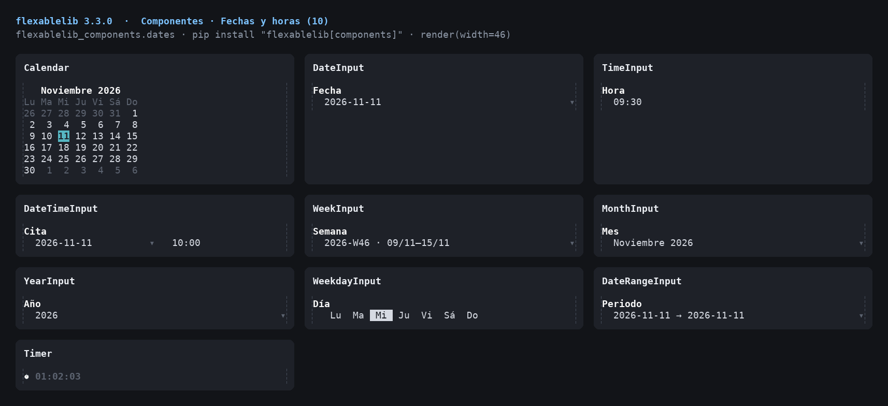
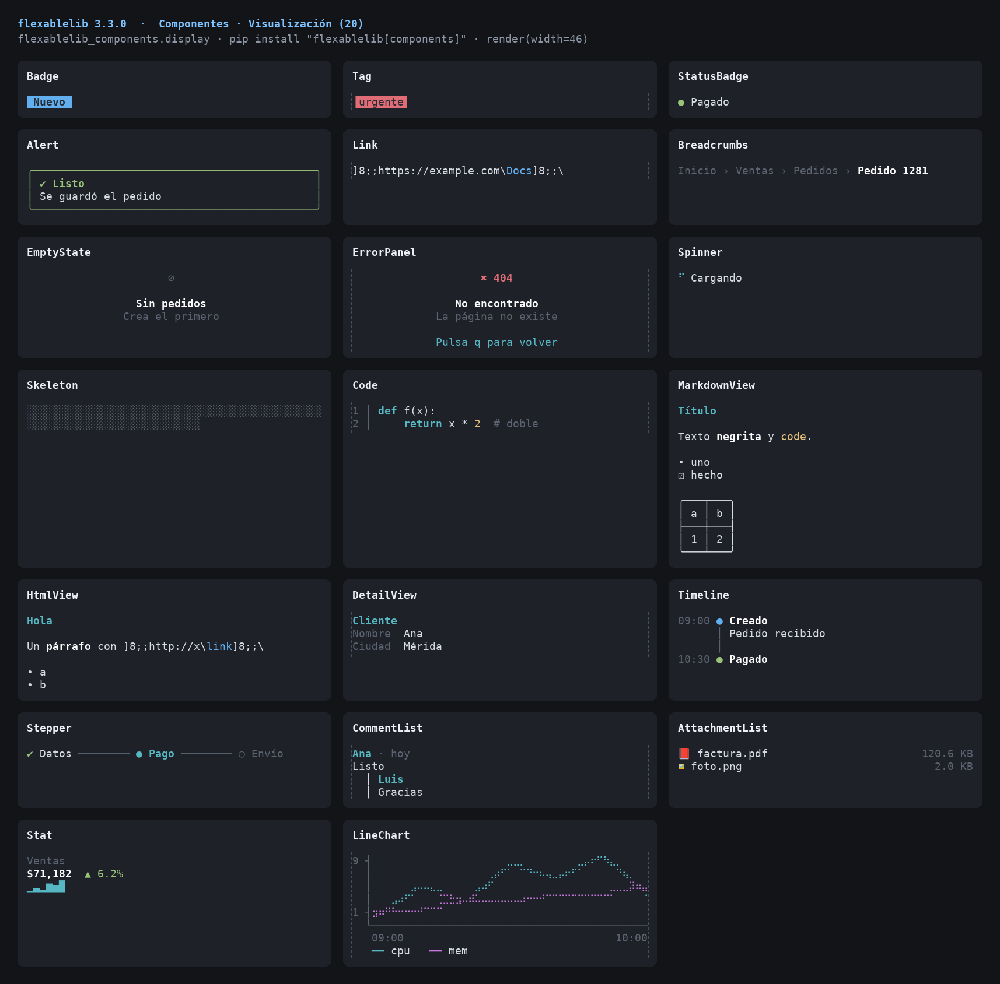
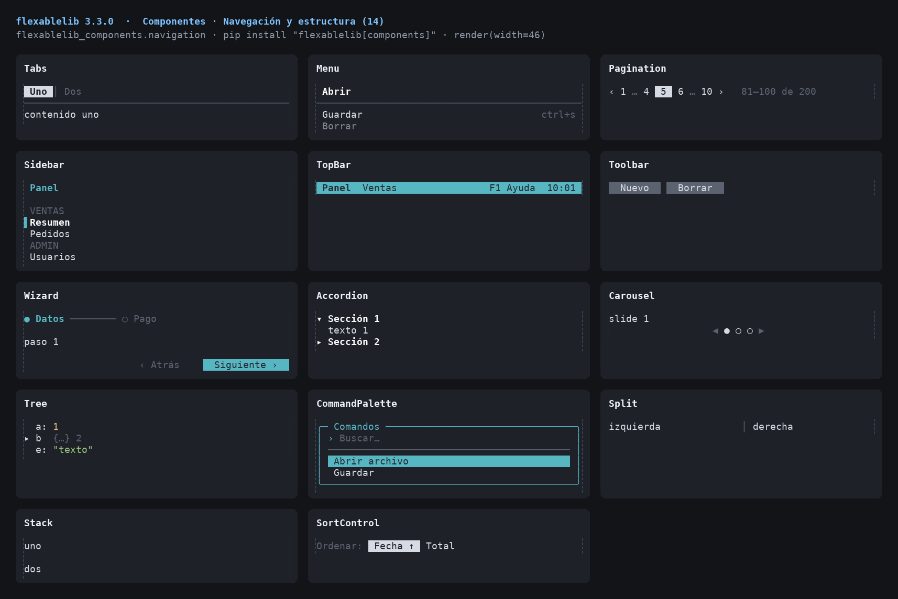
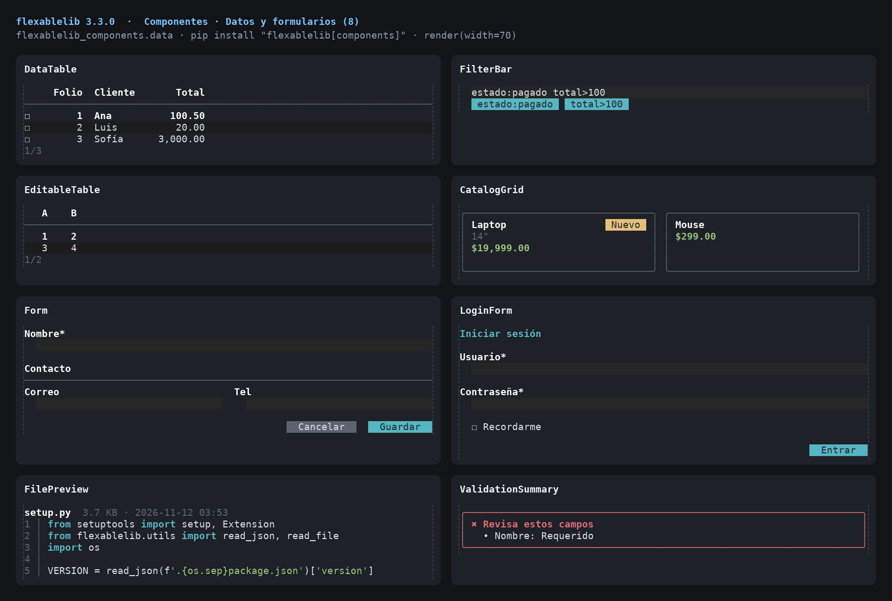
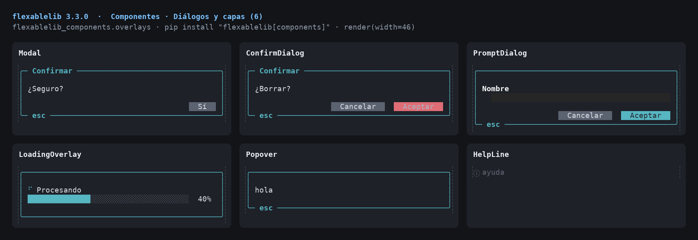

# Terminal components

`pip install "flexablelib[components]"` installs `flexablelib-components`
(and `flexablelib-tui`, which it builds on). It adds 85 components for
interactive terminal applications: inputs, dates, display, navigation, data,
dialogs and pictures. Each one

- renders at any width (`component.render(width=60)`), every line exactly
  that wide, in colour or as plain text (`use_colors=False`, `NO_COLOR`);
- takes the keyboard when focused inside an `App` (Tab / Shift-Tab move the
  focus between what was drawn in the last frame);
- uses the frame primitives of `flexablelib._frames`, so with
  `flexablelib[speed]` the per-line work runs in C.



## A first app

```python
import flexablelib_components as C
from flexablelib import KeyHints
from flexablelib_tui import App

table = C.DataTable(
    [{'key': 'folio', 'title': 'Folio', 'format': str},
     {'key': 'cliente', 'title': 'Cliente'},
     {'key': 'total', 'title': 'Total', 'align': 'r',
      'format': lambda v: '${0:,.2f}'.format(v)}],
    [{'folio': 1281, 'cliente': 'Ana', 'total': 18250.5},
     {'folio': 1280, 'cliente': 'Luis', 'total': 9120.0}],
    selectable=True, on_activate=lambda row: app.notify(row['cliente']))
form = C.Form([C.TextInput('Nombre', required=True),
               C.Switch('Activo', True)],
              on_submit=lambda values: app.notify('Guardado', 'success'))
app = App(body=C.Split(table, form, ratio=0.55),
          footer=KeyHints([('Tab', 'Foco'), ('Ctrl-Q', 'Salir')]),
          bindings={'ctrl+q': lambda: app.exit()})
app.run()
```

`App.run(keys=[...], size=(w, h))` runs the same app headless — no terminal,
the keys fed one by one — and returns the last frame. Tests and the images in
this repository use it. `examples/admin.py` is a complete application.

## The App

| | |
| --- | --- |
| `App(body, header, footer, bindings, interval, on_tick, mouse, use_colors)` | `bindings` maps key names to callables; defaults: `ctrl+c` quits, `tab` / `shift+tab` move the focus. `interval` calls `on_tick(app)` that often. |
| `app.push(layer, position='center', modal=True)` / `app.pop()` | dialogs and floating layers; a modal layer takes every key. |
| `app.notify(message, kind, seconds)` | a toast in the top-right corner. |
| `app.focus(component)`, `focus_next()`, `focus_previous()` | move the focus. |
| `app.render(width, height)` | one frame as a string. |
| `app.dispatch(key)` | route a key: the focused component, then its parents, then the bindings. |

Keys arrive as names: `a`, `A`, `enter`, `escape`, `tab`, `shift+tab`,
`up`/`down`/`left`/`right`, `home`/`end`, `pageup`/`pagedown`, `f1`–`f12`,
`ctrl+a`…, `alt+x`, `paste` (bracketed paste), mouse wheel and clicks with
`mouse=True`. Input works on Linux and macOS (termios) and on Windows
(console API, virtual-terminal output enabled automatically). A resized
window redraws everything; otherwise only changed lines are written.

Writing your own component: subclass `flexablelib_tui.Component`, return a
list of lines from `draw(width, height)`, set `focusable = True` and handle
keys in `on_key(key)` (return True when used), list child components in
`children()`.

## Theme and colour

Every component takes `theme=Theme(accent=..., muted=..., selection=...,
border=..., info=..., success=..., warning=..., error=..., field=...)` with
flexablelib colour specs, and `use_colors`. `App(use_colors=...)` applies to
everything on screen that did not choose for itself.

Presets: `Theme.preset('high-contrast' | 'high-contrast-light' |
'deuteranopia' | 'protanopia' | 'tritanopia' | 'monochrome')`, or
`App(theme='high-contrast')` / `FLEXABLELIB_THEME=high-contrast` for every
component that did not choose one. `theme.contrast()` gives the WCAG
contrast ratio of each colour role. See [ACCESSIBILITY.md](ACCESSIBILITY.md).

## Keyboard, mouse and accessibility (3.4.0)

Every component works with the keyboard alone and, with `App(mouse=True)`,
with the mouse: clicks press, toggle, pick and expand; the wheel scrolls
tables and lists; drags move `Split` dividers. Without colour (or with
`focus_marker=True`) focus and selection show text markers. Every
component has a screen-reader `role`, label, value and states, read in
`App(screen_reader=True)` mode. Spinners and skeletons stand still with
`reduced_motion`; status badges, alerts and timelines carry a symbol and a
word, never colour alone. Details: [INPUT.md](INPUT.md),
[ACCESSIBILITY.md](ACCESSIBILITY.md).

Common arguments on every component: `a11y_label` (accessible name when
there is no visible label), `description`, `role`, `tab_index` (`-1`:
outside Tab, still clickable) and `disabled`.

`DataTable` prints folios, IDs, codes and years without thousands
separators (`'type': 'id'` / `'number'` per column, `id_columns`,
`id_names`); see [FOLIOS.md](FOLIOS.md).

## Pictures (3.5.0)

`Image` shows a picture with the best method the terminal has -- kitty
graphics, iTerm2 inline images, sixel, Unicode blocks, braille, ASCII --
detected automatically; without any, a link opens it in the browser, and
without a browser a warning (`⚠`) gives the file name and the reason.
`ImageViewer` pages through pictures and `FilePreview` draws image files.
They work inside `Card`, `Grid`, `Live` and `App` (frames carry an invisible
mark; the picture is written with the frame and redrawn when its lines
change). Details: [IMAGES.md](IMAGES.md).



## All components

### base

| Component | What it is |
| --- | --- |
| `Input` | Base of the form inputs. |
| `Box` | A titled frame around a component; the frame takes the accent colour while anything inside has the focus. `children` keep their own focus. |
| `Button` | A button: Enter or Space calls `on_press()`. `kind` colours it (`'primary'`, `'danger'`, `'default'`); `shortcut` is a key that presses it from anywhere in its parent (shown after the label). |

### inputs

| Component | What it is |
| --- | --- |
| `TextInput` | One line of editable text. |
| `PasswordInput` | Hidden text; Ctrl-R or F2 shows and hides it. |
| `NumberInput` | A number. Up/Down step it by `step` within `minimum` / `maximum`; `decimals` fixes the decimals shown (`0` gives an int). |
| `ExpressionInput` | A number that also takes arithmetic (`2*3+1`, `(120-15)/4`): the result shows at the right while typing and replaces the expression on Enter or when the focus leaves. |
| `MoneyInput` | An amount: `symbol` before it, thousands separators when not editing, `decimals` (2) after the point. |
| `MaskedInput` | Text with a fixed pattern: `#` a digit, `A` a letter, `X` either, `*` anything; other characters are literals filled in automatically. `mask` may be a name from `MASKS` (`'phone'`, `'rfc'` ...). `value` is the formatted text (`raw=True`: only what was typed). |
| `TextArea` | Several lines of text, wrapped to the width. Enter starts a new line; `submit_key` (`'ctrl+s'`) submits. `rows` is the visible height. |
| `JsonInput` | JSON text; the value is the parsed object. Ctrl-F reformats. |
| `ScanInput` | Codes from a keyboard-wedge barcode/QR reader (or typed): each Enter accepts one code -- cleaned with `strip_prefix` / `strip_suffix` / `transform`, checked against `pattern` and `min_length` / `max_length`, repeated reads within `duplicate_ms` dropped, `unique=True` refusing codes already read -- then calls `on_scan(code)`. `scans` keeps them, `last_code` the latest. Since 3.6.0 the code read stays in the field (`keep_value=True`, the default), so `value` and a `Form` still have it: the next read replaces it as soon as it starts typing, and Enter on it does not read it twice. `keep_value=False` clears the field after every read, as before. |
| `Checkbox` | `[x] label`: Space or Enter toggles. |
| `Switch` | An on/off switch; `labels` names the two states. |
| `RadioGroup` | One of `options`. `layout='vertical'` lists them (Up/Down), `'buttons'` draws a segmented row (Left/Right). Moving selects. |
| `CheckboxGroup` | Several of `options`: Up/Down move, Space toggles. Value: a list. |
| `Select` | A drop-down list. Enter or Space opens it; typing filters; Up/Down move; Enter picks; Escape closes. `max_visible` rows show at once. |
| `Autocomplete` | Text with suggestions from `options` (matching anywhere, case- and accent-insensitive). Up/Down choose a suggestion, Enter or Right accepts it. `strict=True` only accepts an option's label. |
| `ColorInput` | A `#rrggbb` colour with a swatch; Up/Down walk a palette. |
| `IconPicker` | An icon from a grid (`icons`: `(name, symbol)` pairs). Typing filters by name; arrows move; Enter picks. `value` is the name. |
| `CoordinatesInput` | Latitude and longitude, side by side. Value: `{'latitude': ..., 'longitude': ...}`. |
| `FileInput` | A path, typed or picked from a browser (Enter opens it): Up/Down move, Enter opens a folder or picks a file, Backspace goes up, Escape closes. `extensions` limits the files listed; `multiple=True` picks several with Space. `value` is the path (a list with `multiple`). |
| `SignatureInput` | A signature pad of `columns` x `rows` cells (3.6.0): press and drag with the mouse, or with the keyboard -- arrows move the pen, Space puts it down / lifts it, `x` or Delete erase, Backspace undoes the last stroke, `c` clears. `value` is the list of strokes (lists of `(x, y)` cells; `[]` when empty, so `required=True` asks for a signature). `to_text()` gives the drawing as text, `to_bitmap(scale)` / `to_png(scale)` as an image. The pen shows as `+` in reverse, not only a colour. |

### dates

| Component | What it is |
| --- | --- |
| `Calendar` | A month grid. Arrows move by day and week, PgUp/PgDn by month, Ctrl-PgUp/PgDn by year, `t` jumps to today, Enter calls `on_select(date)`. `highlight(date) -> spec` colours days; `range` `(start, end)` shades a span; `mode='week'` selects whole weeks. |
| `DateInput` | A date. Enter opens a calendar; with it closed, `+` / `-` move a day and `t` sets today. `format` is the `strftime` pattern shown. |
| `TimeInput` | `HH:MM` (`seconds=True`: `HH:MM:SS`). Left/Right pick the part, Up/Down change it (by `step` minutes for minutes), digits type it. |
| `DateTimeInput` | A date and a time side by side; the value is a `datetime`. |
| `WeekInput` | A week; the value is its Monday. Shown as `2026-W46 · 09/11–15/11`. |
| `MonthInput` | A month (the value is its first day); PgUp/PgDn change the year. |
| `YearInput` | A year (the value is January 1st, or an `int` with `as_int=True`); the picker shows twelve years, PgUp/PgDn page. |
| `WeekdayInput` | A day of the week (0 = Monday ... 6 = Sunday) as a row of buttons. |
| `DateRangeInput` | A span of dates: in the picker, Enter marks the start then the end, or pick a preset on the left (Up/Down there, Right to the calendar). The value is `(start, end)`. |
| `Timer` | Elapsed time since `start` (until `end`, or now): `01:23:45`. `interactive=True` makes it a stopwatch: Space starts and stops, `r` resets. `clock` returns seconds (`time.monotonic` by default) and is only used by the stopwatch; `start` / `end` may be datetimes. |
| `Stopwatch` | A stopwatch input for forms (3.6.0): Space or Enter start and stop, `l` records a lap, `r` resets; `start()`, `stop()`, `toggle()`, `lap()`, `reset()` from code. `value` is the elapsed `datetime.timedelta` (setting a `timedelta` or seconds stops it there); `laps` the split times (`max_laps` keeps the latest); `on_lap(split)`, and `on_change(value)` on stop and reset. `precision` decimals of the seconds (0-3). |

### display

| Component | What it is |
| --- | --- |
| `Badge` | A short label on a coloured background: `kind` is a theme kind (`'info'`, `'success'`, `'warning'`, `'error'`) or `color`. |
| `Tag` | A tag in a colour; `(etiqueta)` without colours. |
| `StatusBadge` | A status from `options` -- `{value: (label, kind_or_colour)}` -- with a coloured dot: `● Pagado`. |
| `Alert` | A message box: `kind` sets the icon and colour; `title` is optional. `dismissible=True` adds a close hint and lets Escape hide it. |
| `Link` | A hyperlink. On terminals that support OSC 8 it is clickable; the URL is shown after the text when `show_url=True` or colours are off. |
| `Breadcrumbs` | `Inicio › Ventas › Pedido 1281`: the last item is the current one; long trails collapse in the middle to fit. |
| `EmptyState` | A centred icon, title and hint for a view with nothing to show. |
| `ErrorPanel` | An error screen: big code, title, message and what to do next. |
| `Spinner` | An animated spinner with a message; each `render` (or `tick()`) advances it. `style` is `'dots'`, `'line'`, `'arc'` or `'bounce'`. |
| `Skeleton` | Grey placeholder bars while content loads (`lines` of them). |
| `Code` | Source code with line numbers and highlighting for `language` (python, javascript/typescript, sql, bash, json). Long lines are cut; `title` frames it. |
| `MarkdownView` | Markdown drawn for the terminal: headings, emphasis, inline and fenced code (highlighted), quotes, ordered / unordered / task lists, rules, links and pipe tables (as flexablelib tables), wrapped to the width. |
| `HtmlView` | HTML drawn like :class:`MarkdownView` (headings, emphasis, links, lists, quotes, code, tables); scripts and styles are dropped. |
| `DetailView` | Labelled values in aligned columns -- a record's detail. `fields` is a mapping or `(label, value)` pairs; a label starting with `#` is a section heading. `columns=2` lays the pairs out in two columns. |
| `Timeline` | Events down a line: `(when, title, detail)` or dicts with `when`, `title`, `detail`, `kind` / `status`. Also a status history: give `kind` per event (`'success'`, `'error'` ...). |
| `Stepper` | Progress through steps: `✔ Datos ─── ● Pago ─── ○ Envío`. `current` is the active step's index; `layout='vertical'` lists them with their `descriptions`. |
| `CommentList` | A conversation: dicts with `author`, `when`, `text` and optional `replies` (indented below). |
| `AttachmentList` | Files with an icon by type, name and size: `(name, size)` pairs or dicts with `name` and `size`. |
| `Stat` | A KPI: label, big value, change against before (`delta`, a number or text; positive is green unless `invert=True`) and an optional trend sparkline (`trend` values). |
| `LineChart` | Lines on a braille canvas (2x4 dots per cell) with a y axis and x labels. `series` maps names to value lists (or is one list); `height` is in rows. Each series takes a colour from `colors`. |

### navigation

| Component | What it is |
| --- | --- |
| `Tabs` | Tabbed panes: `tabs` is a mapping (or pairs) of title to content. Left/Right (or 1-9) switch while the tab bar has the focus; the content's own components follow it in the focus order. `on_change(index)`. |
| `Menu` | A vertical menu. `items`: labels, `(label, action)`, or dicts with `label`, `action`, `shortcut`, `icon`, `disabled`; `'-'` is a separator. Up/Down move (skipping separators and disabled items), Enter runs the action, a letter jumps to the item starting with it, and an item's `shortcut` runs it directly. `on_select(index, item)`. |
| `ContextMenu` | A :class:`Menu` in a framed popup: `open(app, position)` shows it, Escape or choosing an item closes it. |
| `MenuButton` | A button that opens a :class:`ContextMenu` of `items` below it. |
| `Pagination` | `‹ 1 … 4 [5] 6 … 20 ›` with the item range: Left/Right (or PgUp/PgDn) change page, Home/End jump. `on_change(page)`; pages count from 1. |
| `Sidebar` | Navigation down the side: `sections` maps a heading to items (as in :class:`Menu`). `collapsed=True` (or Ctrl-B) shows only the icons. |
| `TopBar` | The bar across the top: `title` (and `breadcrumbs`) on the left, `actions` -- text or `(key, label)` pairs -- and `status` on the right. |
| `Toolbar` | A row of :class:`Button` s (or `(label, action)` pairs): Left/Right move between them while one has focus; each keeps its own shortcut. |
| `Wizard` | Steps with a stepper on top, the current step's content, and Back / Next / Finish buttons. `steps` are `(title, content)` pairs; `validate(index) -> error or None` guards Next; `on_finish()`. Ctrl-N / Ctrl-P move too. |
| `Accordion` | Collapsible sections: `sections` are `(title, content)` pairs. Up/Down move between headers, Enter/Space toggle; `multiple=False` keeps one open at a time. A single section works as a collapsible panel. |
| `Carousel` | Slides one at a time with `◀ ● ○ ○ ▶`; Left/Right change slide, `autoplay` (in ticks) advances on :meth:`tick`. |
| `Tree` | A collapsible tree. `data` is nested dicts / lists (an object inspector) or `(label, children)` nodes. Up/Down move, Right/Enter expand, Left collapses or goes to the parent, `*` expands everything. `on_select(path, value)` runs on Enter for a leaf. |
| `CommandPalette` | A search box over commands -- `(label, action)` pairs or dicts with `label`, `action`, `hint`, `keywords` -- matched by fuzzy subsequence, best first. Up/Down choose, Enter runs, Escape closes. Open it with `open(app)` (bind it to `ctrl+k` or `/`). |
| `Split` | Two panes side by side (`direction='horizontal'`) or stacked (`'vertical'`), divided at `ratio`; Ctrl-Left/Right (Ctrl-Up/Down) move the divider. |
| `Stack` | Children one below the other (`direction='vertical'`) or side by side (`'horizontal'`, equal widths unless `widths` given), with `gap`. A horizontal stack with `min_width` wraps onto more rows when its children would get narrower than that (four cards become 2 x 2, then a column). |
| `VStack` | Children one below the other that share the height the stack gets (3.6.0): `weights` split the rows left over (0, the default, keeps a child's own height), `min_heights` / `max_heights` bound each child, `gap` separates them and `height` fixes the stack's height. When they need more rows than there are, it scrolls and follows the focus: when a component inside takes the focus, the child holding it comes into view (Tab reaches the ones out of view). Wheel and PgUp/PgDn scroll; `scrollbar` shows a bar while it scrolls. |
| `AppShell` | The frame of an application: `sidebar` on the left, `topbar` above the content, `content` the current page. `pages` maps sidebar labels to content, so choosing an item in the sidebar shows its page. The sidebar hides itself below `sidebar_below` columns (Ctrl-B shows it). |
| `SortControl` | Choose the sort field and direction: Left/Right pick the field, Space or Enter flips ascending/descending. `on_change(field, descending)`. |

### data

| Component | What it is |
| --- | --- |
| `DataTable` | An interactive table. Focused while empty, its `empty` text shows a `▸` (`>`) marker in reverse video. |
| `FilterBar` | Filters typed as a query -- `estado:pagado total>1000 mérida` (`:` contains, `=` / `!=` equal, `>` `<` `>=` `<=` compare, a bare word searches every field) -- shown as chips below. `predicate` is the row filter; `table` (a :class:`DataTable`) is refreshed on every change. |
| `EditableTable` | A :class:`DataTable` whose cells are edited in place: Left/Right choose the cell, Enter edits it (Enter saves, Escape cancels), Ctrl-N adds a row, Ctrl-D deletes the current one. Column `type` `'number'` keeps numbers. `on_edit(row, key, value)` runs after a change. With a `name` it is a field of the `Form` around it: `value` (a copy of the rows) goes into `Form.values()`. |
| `CatalogGrid` | Items as cards in a grid that reflows with the width: dicts with `title`, `subtitle`, `price`, `badge`, `fields` and (3.6.0) `image` -- a path, URL, bytes or bitmap, with `image_alt` (the title by default). Arrows move, Enter or a click on the current card selects it: `selected` / `value` is the item and `on_select(item)` runs. Pictures take `image_height` rows (6 when any item has one), drawn with `image_method`; `image_headers` go with URL downloads. The current card has a heavy border and a `▸` marker. |
| `Form` | Fields with labels, help and validation, laid out in `columns`, with submit / cancel buttons. `fields`: inputs, section titles (strings) or tuples of inputs for one row. Enter in a one-line field moves to the next; Ctrl-S (or the submit button) validates and calls `on_submit(values)`; Escape calls `on_cancel()`. `values()` is the `{name: value}` dict -- since 3.6.0 every named input also inside containers (`Stack`, `VStack`, `Tabs` including hidden tabs, `Wizard` steps, `Accordion` sections, grids, cards) and the rows of a named `EditableTable`; `fields()` lists the inputs the same way. `errors` the last validation. |
| `ValidationSummary` | The list of errors of a form: a `{field: message}` dict or (3.6.0) a list -- of messages, `(field, message)` pairs, dicts with `field` / `message` (or `name` / `error`) or exceptions. With `fields` (a `Form` or a list of inputs) or `on_select` it takes the focus: Up/Down choose an error, Enter or a click moves the focus to its field (by `name`, then `label`) and calls `on_select(field, input)`. `entries` are the `(field, message)` pairs, `messages` the texts. |
| `LoginForm` | User and password, a "remember me" box and an Enter button. `on_login(user, password, remember)` returns True, or an error message shown above the fields. |
| `FilePreview` | A file's name, size, date and -- for text -- its first lines, with code highlighting by extension. Images (and the first page of PDFs and SVGs when a renderer is installed) are drawn with `Image` in `max_lines` rows; `images=False` shows details only. Other binaries show their details only. |

### media

| Component | What it is |
| --- | --- |
| `Image` | A picture from a path, URL, bytes, file object or Pillow image: kitty, iTerm2, sixel, Unicode blocks (`half`, `quadrant`, `sextant`, `braille`) or ASCII, whichever the terminal supports (`method=` or `FLEXABLELIB_IMAGE` forces one); otherwise a link to open it in the browser, or a warning when there is no browser. `alt` is the text alternative; `width`, `height`, `fit` (`contain`, `cover`, `fill`, `none`), `align`, `background`, `upscale`, `animate`, `caption`, `focusable` / `on_open` (Enter, `o`, click: open in the browser), `headers` (3.6.0: sent with a URL download, e.g. `{'Authorization': 'Bearer …'}`; never sent on to redirects nor shown in errors). Focused and drawn as text (alt, warning), it shows a `▸` / `>` marker in reverse video. See [IMAGES.md](IMAGES.md). |
| `ImageViewer` | Several pictures, one at a time: Left/Right change, `f` cycles the fit, Enter opens the current one. Items are sources or `(source, alt)`; `headers` go with URL downloads. When focused the info line has a `▸` (`>`) marker in reverse video, not only a colour. |

### overlays

| Component | What it is |
| --- | --- |
| `Modal` | A framed dialog over the screen: `content` and a row of `buttons` (`(label, action)` pairs or :class:`Button` s; an action returning anything but False closes the dialog). `open(app)` shows it; Escape closes it when `closable`. `width` caps its width. |
| `ConfirmDialog` | Yes / no: `on_confirm()` or `on_cancel()`; `danger=True` colours the confirm button as destructive. |
| `PromptDialog` | Asks for one value: `on_submit(value)` on Enter or Aceptar. |
| `LoadingOverlay` | A spinner and message over the screen that holds the focus while work runs: `show(app)` / `hide()`; `progress` (0-1) adds a bar. |
| `Popover` | Floating content at a position (`'top-right'`, `(x, y)`...); `modal=False` leaves the focus where it was. |
| `HelpLine` | One line with the hint of whatever has the focus: its `help`, `tooltip` or `hint` attribute. Put it above the footer; it is the terminal version of a tooltip. |


The `flexablelib-tui` package adds `ScrollView`, `ProgressBar`, `Sparkline`,
`BarChart`, `StatusBar`, `KeyHints`, `LogView`, `Screen` and `Live`.

## What is not included, and why

| Not included | Why |
| --- | --- |
| Signature pads (drawing with a pointer) | A terminal has no freehand pointer input; mouse reports are cell clicks, not strokes. |
| Image inputs (picking a picture by drawing or pasting it) | A terminal cannot paste pixels; `FileInput` picks the file and `Image` shows it. Image viewers and previews exist since 3.5.0 (`Image`, `ImageViewer`, `FilePreview`). |
| Rich-text (HTML/PDF) editors | WYSIWYG editing needs a document model and a renderer far beyond a terminal widget; `TextArea`, `MarkdownView` and `HtmlView` cover writing and showing text. |
| On-screen numeric keypad | The physical keyboard is always there. |
| Share banners | Web sharing has no terminal equivalent; a `Link` (OSC 8) opens a URL in terminals that support it. |
| Spreadsheet import dialogs | `Table.from_excel` / `from_csv` read the files directly. |
| Hidden inputs | Values that should not be shown belong in the code or in `Form.values()`. |
| Camera barcode scanning | No camera access from a terminal; `ScanInput` reads keyboard-wedge (USB/Bluetooth) scanners, which type the code followed by Enter. |

## Gallery









