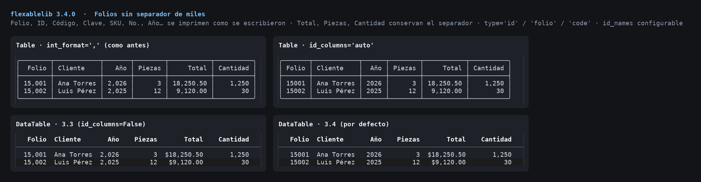

# Folios and other identifiers

A folio, an ID, a postal code or a year is an integer, but it is not a
quantity: `1,281` reads as "one thousand two hundred eighty-one", and a
folio should read `1281`. Since 3.4.0 flexablelib tells **identifier
columns** from **quantity and money columns**: identifiers print exactly
as typed, quantities and money keep their thousands separators.



## Tables

`Table` keeps its 3.3 behaviour unless you ask:

```python
from flexablelib import Table
t = Table(rows=[[1281, 15000, 25, 2026]],
          headers=['Folio', 'Total', 'Piezas', 'Año'])
t.int_format = ','
t.id_columns = 'auto'      # Folio and Año are identifiers
print(t)                   # 1281 | 15,000 | 25 | 2026
```

| `id_columns` | Meaning |
| --- | --- |
| `None` / `False` (default) | `int_format` applies to every integer column, as before |
| `'auto'` / `True` | columns whose name says "identifier" (below) |
| `['Folio', 3]` | these columns, by header or position |

`id_names` replaces the words used by `'auto'`
(`t.id_names = ['folio', 'pedido']`). `leading_zeros` and `custom_format`
still apply to id columns. `to_excel` writes id columns without a
thousands format and the rest with `#,##0`, so Excel shows the same thing.

## Components

`DataTable` and `EditableTable` detect identifiers by default
(`id_columns='auto'`):

```python
DataTable(['Folio', 'Cliente', {'title': 'Total', 'type': 'money'},
           {'title': 'Ref', 'type': 'id'}], rows)
```

- `'type': 'id'` (or `'folio'`, `'code'`, `'clave'`, `'key'`) always
  prints as typed;
- `'type': 'number'` (or `'money'`, `'quantity'`, `'amount'`, `'int'`,
  `'float'`) always keeps separators, whatever the name;
- `id_columns=False` restores separators everywhere, a list names the
  columns, `id_names=[...]` replaces the word list.

## Detection by name

`flexablelib.is_id_column(name, names=None, quantity_words=None)`: a column
is an identifier when its whole name, or one of its words (split on
spaces, `_`, `.`, `-` and camelCase), is in `flexablelib.ID_COLUMN_NAMES`,
and none of its words is a quantity word.

- identifiers: `Folio`, `folio_fiscal`, `ID`, `cliente_id`, `ClienteId`,
  `Código postal`, `SKU`, `No. pedido`, `#`, `Clave`, `RFC`, `Teléfono`,
  `Año`, `Factura`, `Serie`, `Lote`, `EAN`, `UUID` ...
- not identifiers: `Total`, `Cantidad`, `Importe`, `Precio`, `Saldo`,
  `Piezas`, `No. de piezas`, `Pedidos`, `Clientes` ...

Accents and case are ignored, so `Codigo`, `CÓDIGO` and `código` match.
