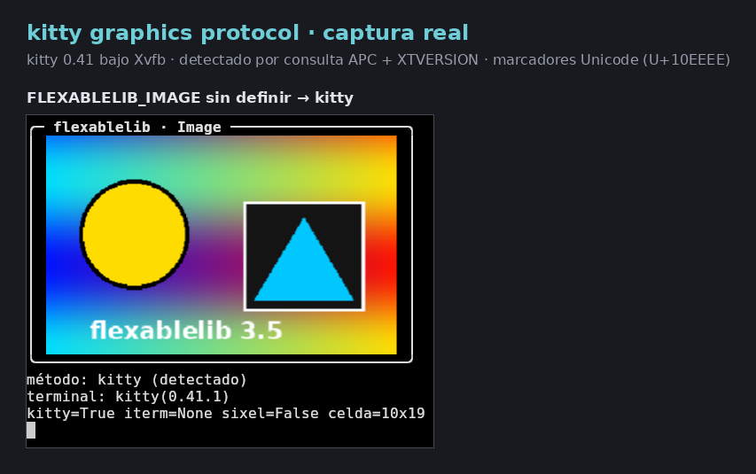
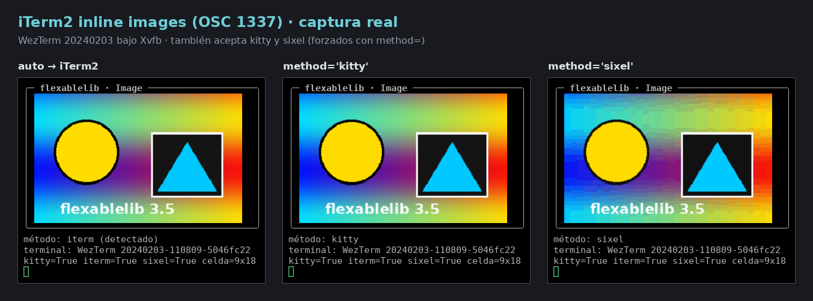
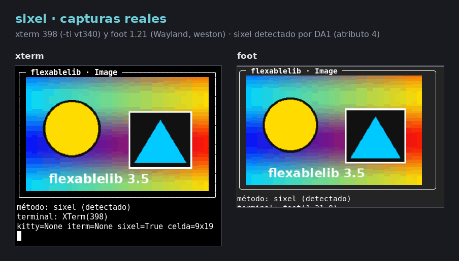
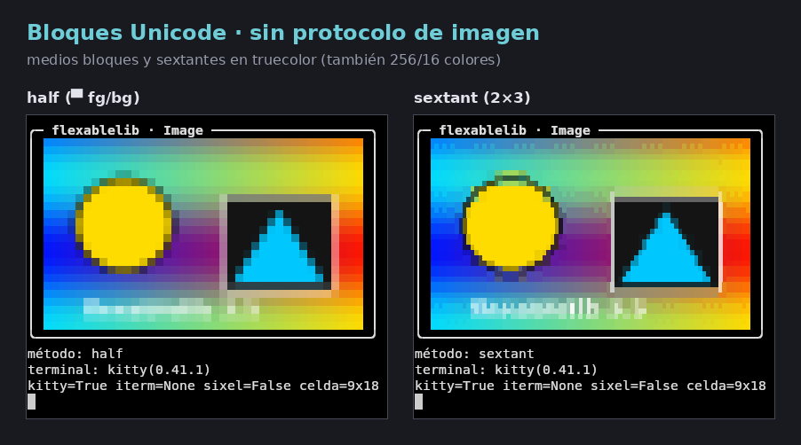
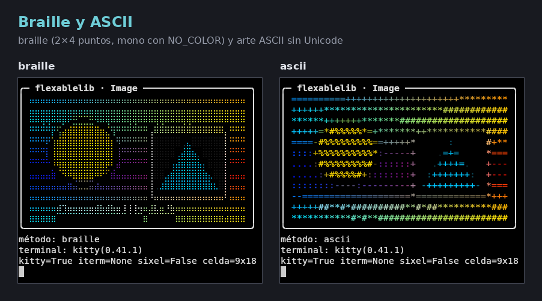
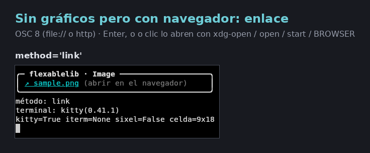
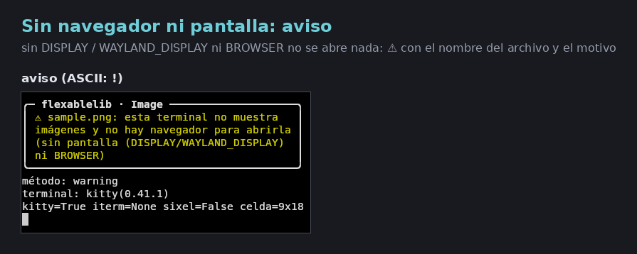
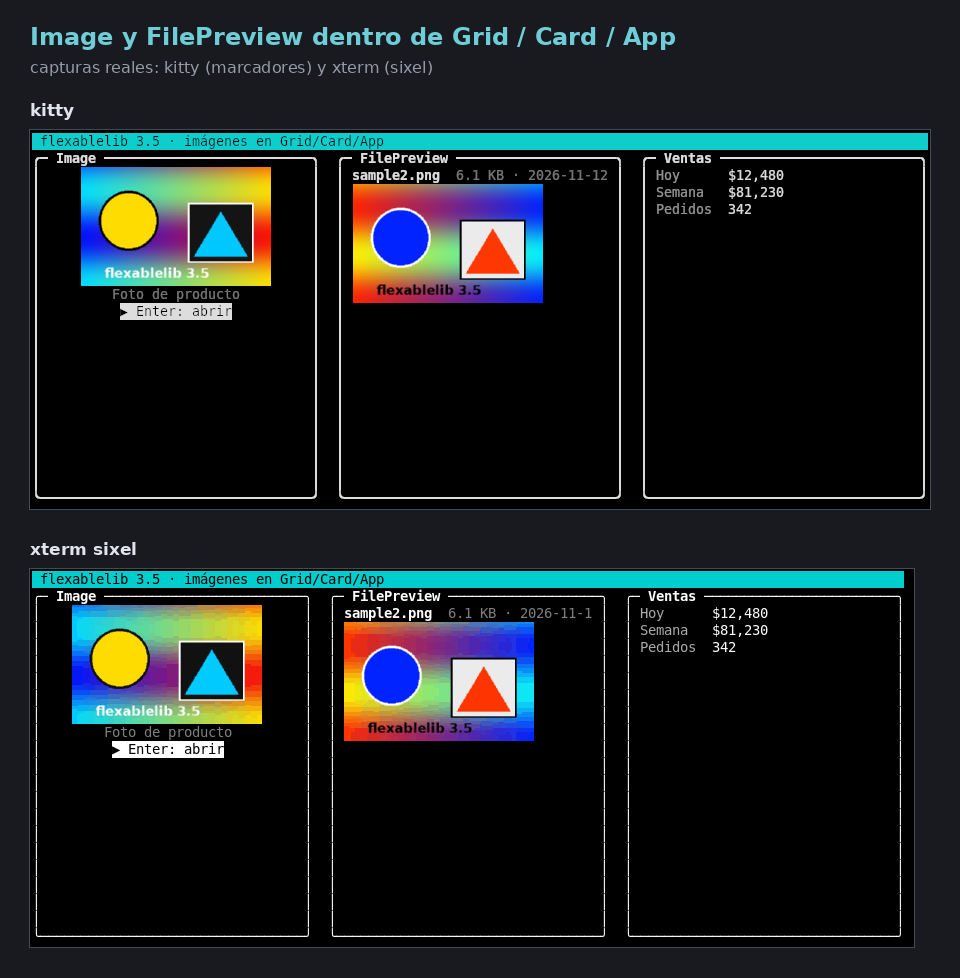
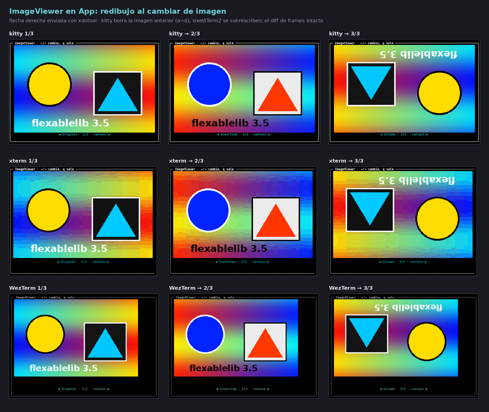
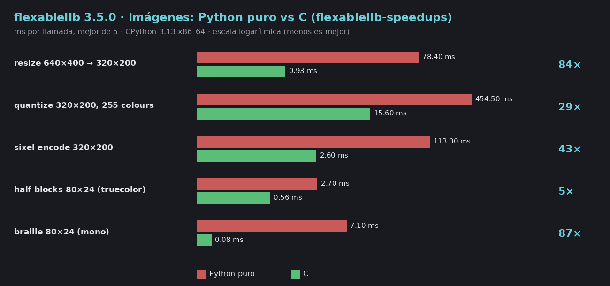

# Pictures in the terminal

`flexablelib-components` 3.5.0 adds `Image` and `ImageViewer`, and
`FilePreview` now draws pictures. Every terminal gets the best picture it can
show, decided automatically; when it cannot show pictures at all, a link
opens the file in the browser, and when there is no browser either, a
warning says so instead of trying to open anything.

```
pip install "flexablelib[images]"     # Pillow: JPEG, WebP, TIFF...
pip install "flexablelib[components]" # PNG, GIF, BMP, PPM without Pillow
```

```python
import flexablelib_components as C
from flexablelib import Card

print(Card('Producto', body=C.Image('foto.png', alt='Silla de madera',
                                     width=40)))
```

## The fallback chain

| Order | Method | Terminals | Notes |
| ---: | --- | --- | --- |
| 1 | **kitty graphics protocol** | kitty, Ghostty, WezTerm, Warp | With Unicode placeholders (kitty 0.28+, Ghostty, and under tmux) the picture is text: it scrolls, sits inside layouts and passes through tmux (`set -g allow-passthrough on`). |
| 2 | **iTerm2 inline images** (OSC 1337) | iTerm2, WezTerm, VS Code (`terminal.integrated.enableImages`), Konsole, mintty, rio | Pixel size given exactly, proportions kept. |
| 3 | **sixel** | xterm (`-ti vt340`), foot, mlterm, contour, Windows Terminal 1.22+, Konsole, tmux 3.4+ built with sixel | Median-cut palette of up to 255 colours (or what XTSMGRAPHICS reports), transparency kept. |
| 4 | **Unicode blocks** | any terminal with Unicode | `half` (▀ with foreground and background: 1×2 pixels per cell), `quadrant` (2×2), `sextant` (2×3), `braille` (2×4 dots); truecolor, 256 or 16 colours, or mono with ordered dithering. |
| 5 | **ASCII** | anything | Luminance ramp ` .:-=+*#%@`, coloured when colour is on. |
| 6 | **Link** (OSC 8) | a terminal that cannot show the picture, when a browser can open it | `file://` for paths, the URL for `http(s)`. Enter, `o` or a click open it with `BROWSER`, `xdg-open`/`gio` (Linux and the BSDs with `DISPLAY` or `WAYLAND_DISPLAY`), `open` (macOS), `start` (Windows) or `wslview` (WSL). |
| 7 | **Warning** | no browser and no display (SSH sessions, containers, CI) | `⚠ foto.png: … no hay navegador para abrirla (sin pantalla …)` (`!` in ASCII mode). Nothing is started. |

The link and the warning are also used when the picture cannot be decoded
(damaged file, a format that needs Pillow) or does not fit.









All the screenshots above are real terminals (kitty 0.41, WezTerm
20240203, xterm 398, foot 1.21) running under Xvfb.

## Detection

`flexablelib_tui.graphics.detect()` returns a cached `GraphicsInfo`:

1. **Environment**: `TERM`, `TERM_PROGRAM`, `KITTY_WINDOW_ID`,
   `WEZTERM_PANE`, `KONSOLE_VERSION`, `WT_SESSION`, `TMUX` (and
   `tmux display -p '#{client_termname}|#{client_termfeatures}'`,
   `allow-passthrough`), `STY`; `NO_COLOR` / `COLORTERM` for colour, the
   locale for Unicode.
2. **Asking the terminal**, only when both standard streams are terminals,
   once per process, with a 0.3 s limit: the kitty graphics query (APC),
   cell and window size in pixels (`CSI 16 t`, `CSI 14 t`, then
   `TIOCGWINSZ`), sixel colour registers (XTSMGRAPHICS), XTVERSION, and DA1
   last (attribute 4 = sixel; every terminal answers DA1, so the wait ends
   there). `App` asks through its own terminal and replays any key typed
   meanwhile. The query is skipped for `TERM=dumb`, the Linux console,
   Terminal.app (it would print the query) and inside tmux (the environment
   is used instead). Windows consoles strip APC sequences, so kitty is not
   used there.

`GraphicsInfo.summary()` lists what was found; `info.best()` is the method
that would be used.

### Forcing a method

`Image(method=...)` or the environment variable

```
FLEXABLELIB_IMAGE=kitty | iterm | sixel | blocks | half | quadrant | sextant | braille | ascii | link | none
```

`blocks` uses `Image(blocks=...)` (default `half`). `none` shows only the
alternative text in brackets. `FLEXABLELIB_NO_BROWSER=1` says there is no
browser (the warning instead of the link).

## `Image`

| Parameter | Meaning |
| --- | --- |
| `source` | path, `file://` or `http(s)://` URL (5 s timeout, 64 MB cap), bytes, a file object, a Pillow image or a `Bitmap` |
| `alt` | the text alternative (screen readers, linear mode, `TERM=dumb`, captions); the accessibility audit reports images without it |
| `width`, `height` | maximum size in cells (default: what the layout offers) |
| `fit` | `contain` (all of it, proportions kept), `cover` (fills the area, cropped), `fill` (stretched), `none` (pixels 1:1, cropped) |
| `method`, `blocks` | see above |
| `align` | `center`, `left`, `right` |
| `background` | colour behind transparent pixels (`'#fff'`, `(r, g, b)`) |
| `upscale` | `False` never enlarges small pictures |
| `animate` | animated GIF/WebP in `Live`/`App` (first frame otherwise and with reduced motion) |
| `caption` | `True` adds the alternative text (or file name) below, as a link |
| `cell_size` | `(w, h)` in pixels, when detection cannot know it |
| `focusable`, `on_open` | Enter, `o` or a click open the picture in the browser (or call `on_open(image)`); without a browser a notice and an announcement say why, and nothing is opened |

`image.used_method` tells what the last render used. Sizes keep the
proportions using the cell size in pixels (detected, or 10×20 assumed).

`ImageViewer(images)` shows one image at a time: Left/Right (PgUp/PgDn)
change image, `f` cycles the fit, Enter opens the current one.
`FilePreview` draws image files (and the first page of PDFs and SVGs, see
below) in at most `max_lines` rows; `images=False` keeps the old details-only
view.

## Inside layouts, Live and App

A picture inside a frame is blank cells plus an invisible, zero-width mark.
Widths, padding, borders and the frame diff all treat it as text; the mark
becomes the kitty, iTerm2 or sixel sequence only when the frame is written
(`str(card)`, `print(grid)`, `Live`, `App`). When something on a line a
picture covers changes, `Live` redraws the picture; kitty pictures that
leave the screen are deleted (`a=d`), and sixel and iTerm2 pictures are
overwritten by the new text. Kitty placeholders are ordinary characters, so
they need nothing special.




## Formats

| Format | Without Pillow | With Pillow (`flexablelib[images]`) |
| --- | --- | --- |
| PNG (every colour type and depth, transparency, interlaced) | yes | yes |
| GIF (frames, transparency, interlaced, disposal) | yes | yes |
| BMP (1–32 bit, bit fields) | yes (RLE needs Pillow) | yes |
| PPM / PGM / PBM | yes | yes |
| JPEG, WebP, TIFF, ICO | no: link or warning with "instala flexablelib[images]" | yes |
| SVG | `rsvg-convert` if installed | also `cairosvg` (`flexablelib[svg]`, needs the cairo library) |
| PDF (first page) | `pdftoppm` (poppler) if installed | also PyMuPDF if installed |

`FLEXABLELIB_NO_PILLOW=1` ignores Pillow (tests, comparisons).

## Speed

Resizing (area average), colour quantization (median cut), sixel encoding
and the block/braille conversion are in C in `flexablelib-speedups`, with
the pure Python versions as fallback; the tests check both give identical
bytes. `FLEXABLELIB_IMAGES=python` forces Python.

| Operation | Python | C | Speed-up |
| --- | ---: | ---: | ---: |
| resize 640×400 → 320×200 | 78.4 ms | 0.93 ms | 84× |
| quantize 320×200, 255 colours | 454.5 ms | 15.60 ms | 29× |
| sixel encode 320×200 | 113.0 ms | 2.60 ms | 43× |
| half blocks 80×24 (truecolor) | 2.7 ms | 0.56 ms | 5× |
| braille 80×24 (mono) | 7.1 ms | 0.08 ms | 87× |

Best of 5, CPython 3.13, x86_64; `python tools/bench_images.py`.



## Accessibility

- Screen-reader mode and `TERM=dumb`: the alternative text, never escape
  sequences (`Imagen: Silla de madera (foto.png)`).
- `NO_COLOR` / no colour: text methods turn mono (braille by default);
  pixel protocols keep working with the picture in grey.
- ASCII mode: ASCII art, `->` for the link, `!` for the warning.
- The audit (`accessibility.audit`) reports `no alt text` for an `Image`
  without `alt`; a focusable `Image` shows a visible focus line.

## Limitations

- Terminals without any image protocol get blocks or ASCII: recognisable,
  not photographic.
- Under tmux, kitty pictures need `allow-passthrough on` and a kitty or
  Ghostty client; iTerm2 images are not passed through. GNU screen gets text
  modes.
- Sixel palettes have at most 255 colours, so gradients band slightly.
- Pictures are redrawn whole when a covered line changes; very large
  pictures at high frame rates cost bandwidth (kitty placeholders avoid it).
- Animation needs `animate=True` and an app that redraws (ticks).
