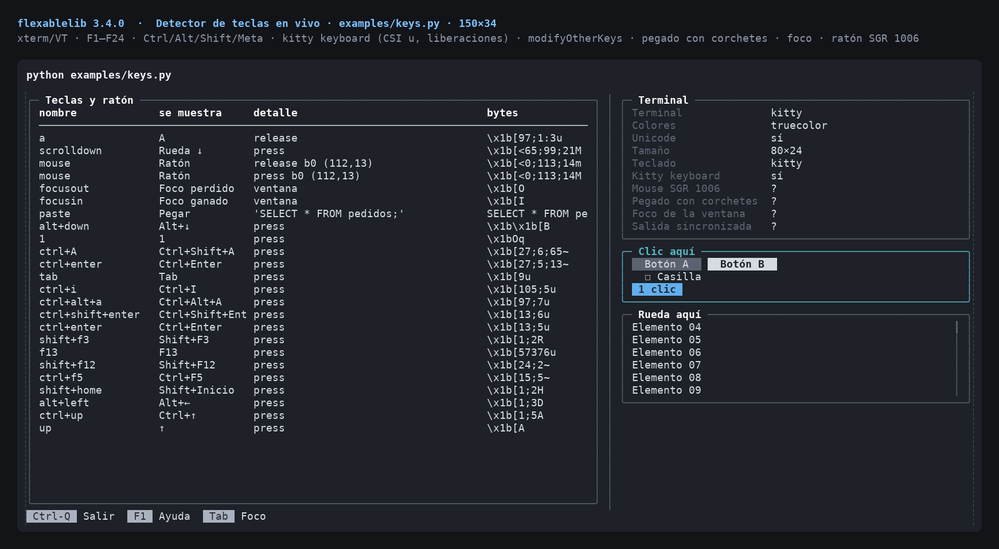
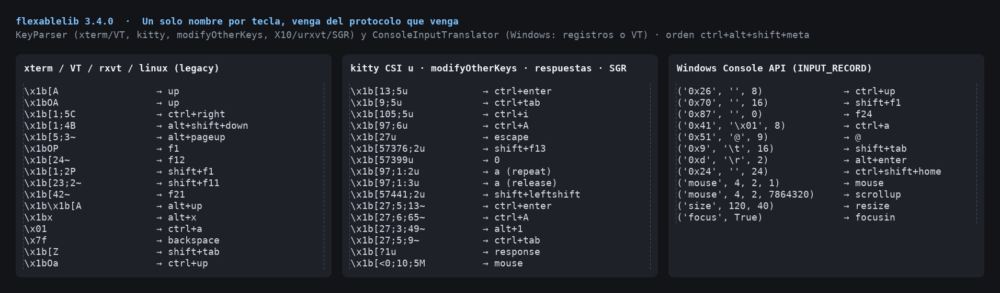
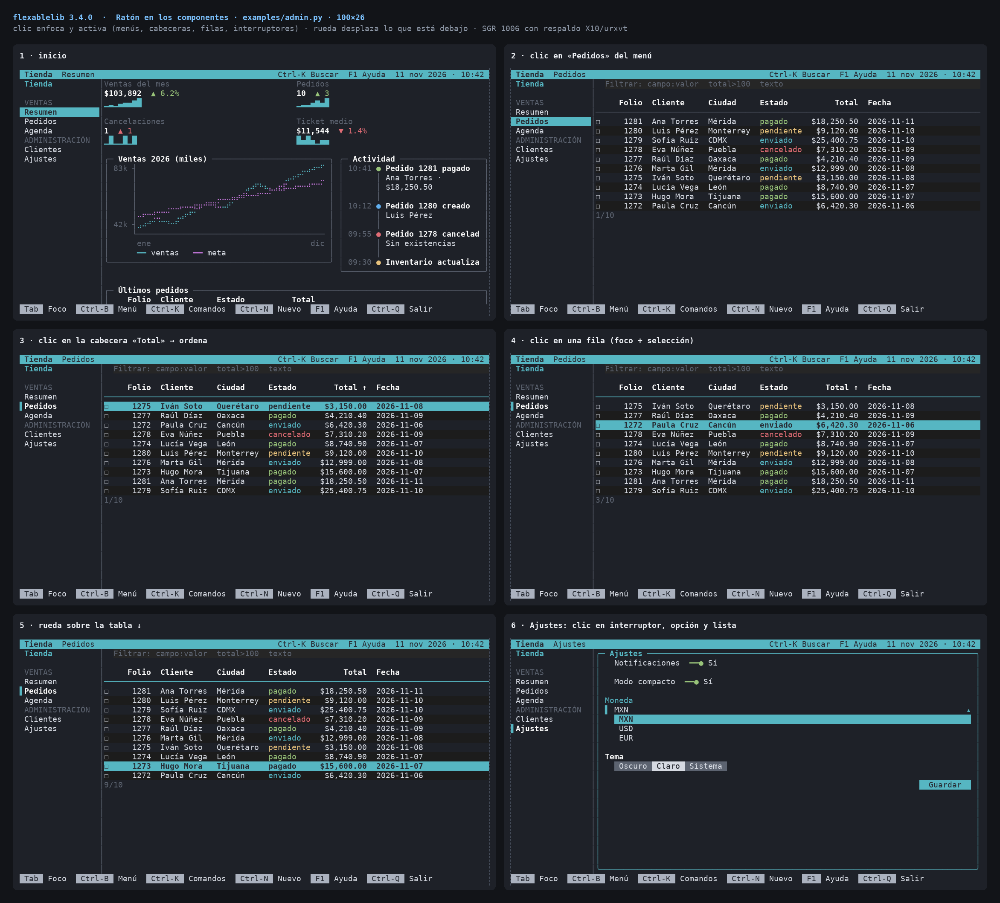

# Keyboard and mouse input

`flexablelib-tui` (`pip install "flexablelib[tui]"`) reads the keyboard and
the mouse on Linux, macOS and Windows and gives every key **one name**,
whatever protocol the terminal speaks. This page covers the names, the
protocols, terminal capabilities, the key map and the mouse.



`python examples/keys.py` is a live detector: every key, combination,
paste, focus change and mouse event, with its name, how it is shown to
people and the raw bytes.

## Key names

A key is a `Key` (a `str` subclass) such as `'a'`, `'enter'`, `'f5'`,
`'ctrl+s'`, `'ctrl+alt+shift+f12'`:

- modifiers always come in the order `ctrl+alt+shift+meta+super+hyper`;
- Shift folds into letters: Ctrl+Shift+A is `'ctrl+A'` (Alt+Shift+X is
  `'alt+X'`), while Shift with a non-letter keeps the prefix
  (`'shift+tab'`, `'shift+f3'`, `'ctrl+shift+enter'`);
- named keys: `up down left right home end pageup pagedown insert delete
  backspace tab enter escape space f1`…`f24` (`f35` with kitty);
- special keys: `'paste'` (bracketed paste; the text is in `key.char`),
  `'focusin'` / `'focusout'` (window focus), `'mouse'` (with
  `key.mouse`), `'scrollup'` / `'scrolldown'` (wheel), `'resize'`,
  `'response'` (a terminal answer, with `key.data`);
- `key.event` is `'press'`, `'repeat'` or `'release'` (repeats and releases
  only arrive with the kitty protocol and `releases=True`);
- `key.raw` holds the bytes that produced the key.

`normalize_key('Control+Shift+A') == 'ctrl+A'` and `key_label('ctrl+s') ==
'Ctrl+S'` (`key_label('up', ascii=True) == 'Arriba'`).

## Protocols



`KeyParser` understands, in one stream:

| Source | Examples |
| --- | --- |
| xterm / VT100 / VT220 | `CSI A`, `SS3 P`, `CSI 1;5C`, `CSI 15;3~`, `CSI 1;2P`, 8-bit CSI |
| rxvt / urxvt | `CSI a`, `SS3 a`, `CSI 2$`, `CSI 2^`, `CSI 2@` |
| Linux console | `CSI [A` … `CSI [E` |
| Alt as ESC prefix | `ESC x` → `alt+x`, `ESC ESC [A` → `alt+up` |
| kitty keyboard protocol | `CSI 13;5u` (`ctrl+enter`), `CSI 105;5u` (`ctrl+i`, not Tab), keypad, F13–F35, press / repeat / release |
| xterm `modifyOtherKeys` | `CSI 27;5;13~` (`ctrl+enter`), `CSI 27;6;65~` (`ctrl+A`) |
| bracketed paste | `CSI 200~ … CSI 201~`, even split across reads |
| focus reporting | `CSI I` / `CSI O` |
| mouse | SGR 1006 (`CSI <0;10;5M`), urxvt 1015, X10 (`CSI M` + 3 bytes) |
| terminal answers | DA1/DA2/DA3, kitty flags, DECRQM, XTVERSION, cursor position, OSC/DCS/APC strings |

A lone Escape waits 25 ms for the rest of a sequence; incomplete sequences
are kept for the next read.

### Choosing the protocol

`Terminal(keyboard='auto')` (the default) asks the terminal on start-up
(`capabilities.probe`): it pushes the **kitty keyboard protocol** when the
terminal answers the kitty query (kitty, WezTerm, foot, Ghostty, recent
iTerm2, Alacritty), turns on **xterm `modifyOtherKeys`** on other
xterm-compatible terminals, and keeps plain sequences otherwise. Both
richer modes tell apart keys the legacy encoding merges: Ctrl+I vs Tab,
Ctrl+M vs Enter, Ctrl+Enter, Ctrl+Shift+letter, Escape vs Alt. Everything
is popped and restored on exit. `keyboard='kitty' | 'modify' | 'legacy'`
forces one; `term.protocol` says which is active.

### Windows

On Windows the console is read through the Win32 API (`wincon`):

- `ReadConsoleInputW` records (`windows='records'`): every key with its
  virtual-key code and modifiers, including AltGr characters, F13–F24,
  surrogate pairs (emoji), mouse, wheel, resize and focus records;
- virtual-terminal input (`ENABLE_VIRTUAL_TERMINAL_INPUT`, the default where
  available): the console sends the same escape sequences as xterm. Windows
  sends no sequence for F13–F24 in this mode; use `windows='records'` if
  you need them;
- the legacy `msvcrt` reader when stdin is not a console
  (`windows='msvcrt'` forces it).

CI runs a real console on `windows-latest`: a child process started with
`CREATE_NEW_CONSOLE` injects records with `WriteConsoleInputW` and reads
them back through records mode, VT mode and the `Terminal` class
(`tests/wincon_child.py`).

## Capabilities

```python
from flexablelib_tui import detect_capabilities
caps = detect_capabilities()          # environment only, no output
print(caps.color, caps.unicode, caps.size, caps.keyboard)
print('\n'.join(caps.summary()))
```

`detect` reads `NO_COLOR`, `FORCE_COLOR` (0–3), `TERM` (`dumb` turns
colour off), `COLORTERM`, `TERM_PROGRAM`, `KITTY_WINDOW_ID`, `WT_SESSION`,
the locale (Unicode) and the window size. `capabilities.probe(terminal)`
asks the terminal itself (kitty flags, DECRQM for paste/focus/SGR
mouse/synchronized output, XTVERSION, DA1 as the sentinel) and replays any
key typed during the probe.

## Key map

```python
from flexablelib_tui import App, KeyMap
keymap = KeyMap(remap={'ctrl+j': 'down', 'ctrl+k': 'up'},
                actions={'quit': ['ctrl+q'], 'help': ['f1', '?']})
app = App(body=..., keymap=keymap)
keymap.save('keys.json')              # KeyMap.load('keys.json')
```

`remap` renames incoming keys before anything sees them; `actions` name
what keys do (`focus_next`, `focus_prev`, `activate`, `cancel`, `quit`,
`help`, `read_screen` by default). `describe('help')` gives
`'F1 / ?'` for help screens and `conflicts()` lists keys bound to two
actions.

## Mouse



`App(mouse=True)` turns on clicks, drags and the wheel; `mouse='hover'`
also tracks the pointer (`component.hovered`). The app knows which
component drew each cell of the last frame, so:

- a press focuses what is under the pointer (only components Tab can
  reach; a calendar inside a date input leaves the focus on the input) and
  passes the event to it, innermost first;
- **clicks** press buttons, toggle checkboxes and switches, pick radio
  options, tabs, menu and sidebar items, pagination pages, sort fields,
  calendar days, month/year cells, weekday and time parts, open and pick
  selects, autocomplete suggestions and file entries, expand tree nodes and
  accordion sections, move the carousel, open links and dismiss alerts and
  notifications; in a `DataTable` a click selects the row, a second click
  activates it (`on_activate`), the checkbox column toggles selection and
  the header sorts;
- the **wheel** scrolls what is under the pointer (`ScrollView`, tables,
  lists; others get `up`/`down`);
- **drags** move a `Split` divider and the scroll bar thumb of a
  `ScrollView`; the component that got the press receives the drag and the
  release;
- a modal dialog swallows clicks outside it.

Components react through `on_mouse(event)`: `event` is a `MouseEvent`
`(button, x, y, pressed)` in the component's own coordinates, with
`event.action` (`'press'`, `'release'`, `'drag'`, `'move'`, `'scroll'`)
and `event.mods`. `_Themed.hot(row, action, x0, x1)` registers clickable
spots while drawing.
