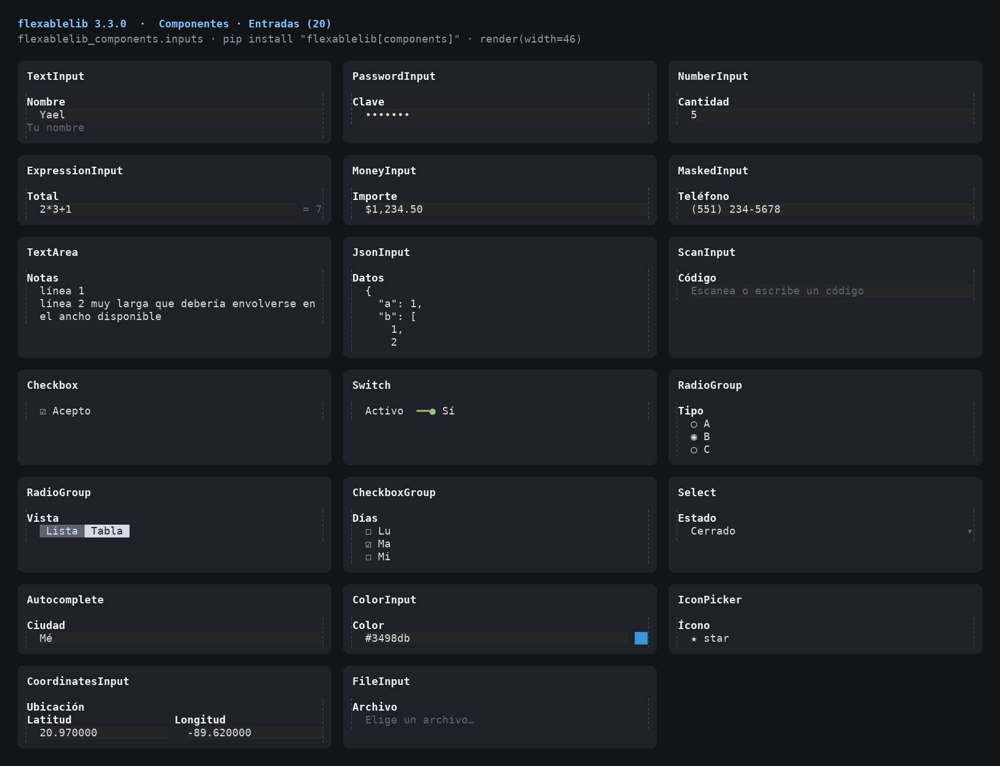
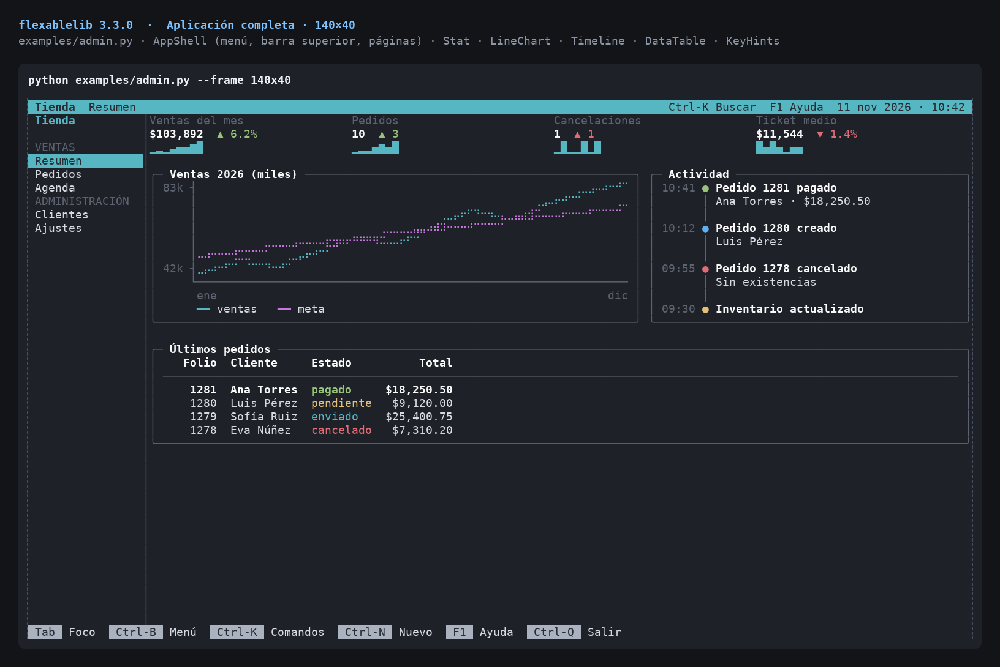

# flexablelib-components

Interactive terminal components for [flexablelib](https://github.com/Opus-Perpetuus/flexablelib): form inputs, dates and times, interactive and editable tables, filters, forms, menus, tabs, wizard, tree, command palette, dialogs, charts and more, all keyboard driven.

Install it with `pip install flexablelib[components]`.

Documentation: [COMPONENTS.md](https://github.com/Opus-Perpetuus/flexablelib/blob/main/docs/COMPONENTS.md)

