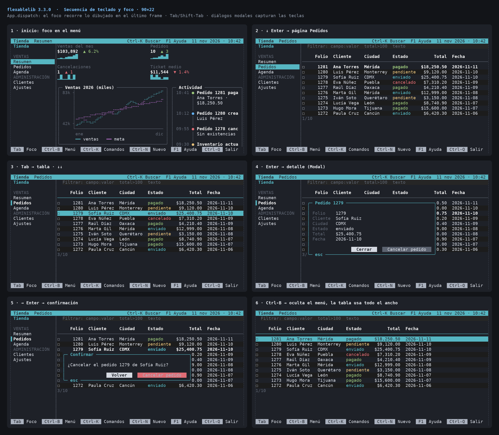

# flexablelib-tui

Terminal interfaces for [flexablelib](https://github.com/Opus-Perpetuus/flexablelib): widgets, full-screen layout, in-place redraw that writes only the lines that changed, keyboard input on Linux, macOS and Windows, focus, key bindings, scrolling, dialogs and resize.

Install it with `pip install flexablelib[tui]`.

Documentation: [LAYOUT.md](https://github.com/Opus-Perpetuus/flexablelib/blob/main/docs/LAYOUT.md) and [COMPONENTS.md](https://github.com/Opus-Perpetuus/flexablelib/blob/main/docs/COMPONENTS.md)

